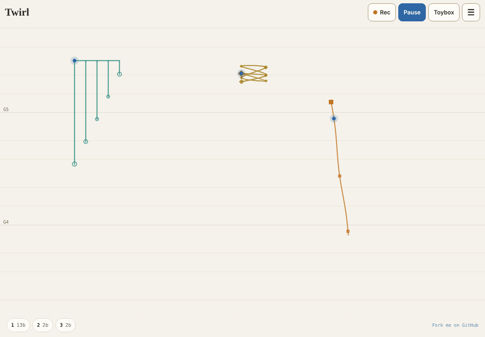
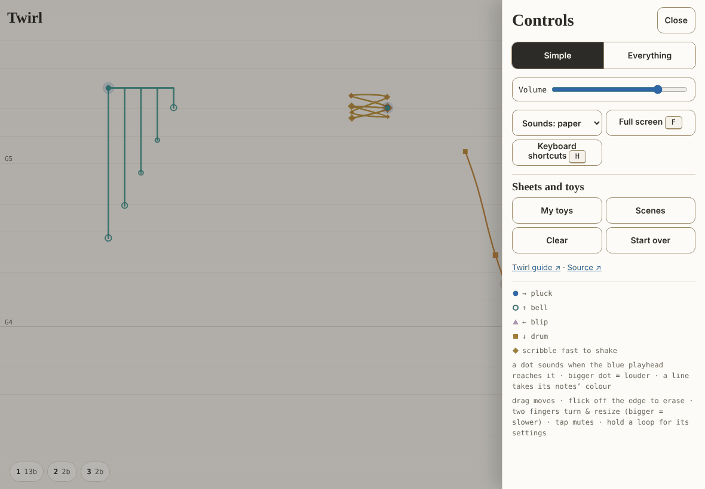
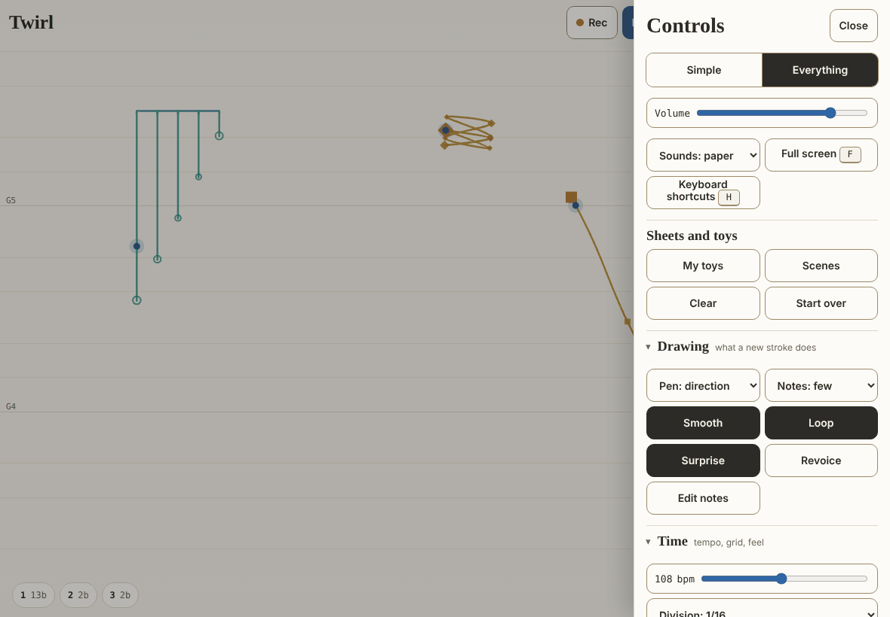
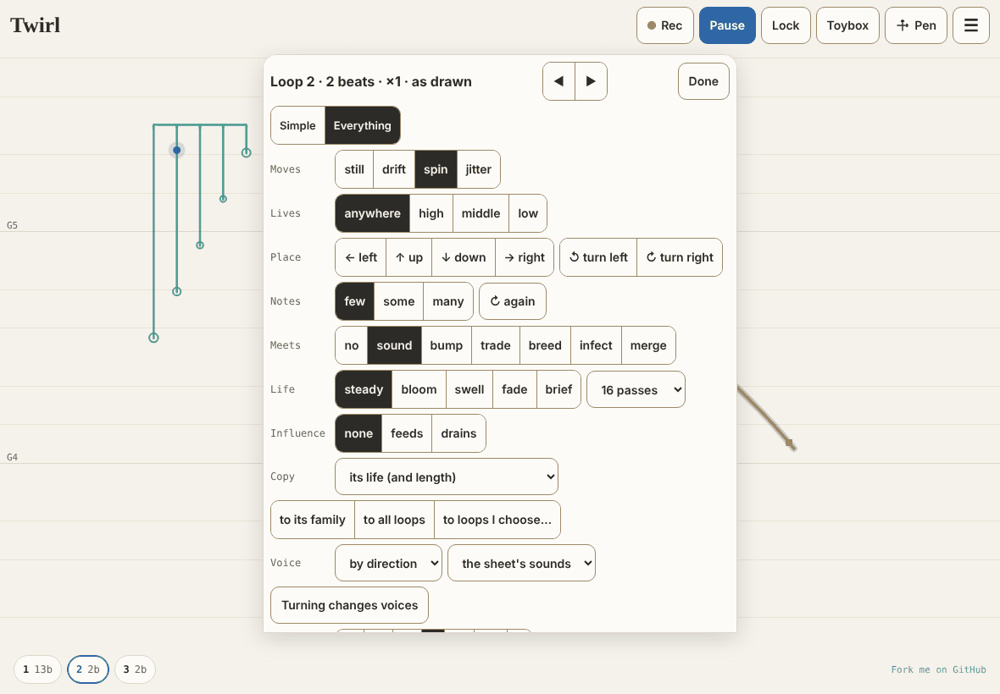

# Twirl — design brief

*Prepared 2026-10-25 for a pass by the design agent (Claude Design), after a
first rearrangement of the drawer done in code. Written to be read cold. Read
the suite's [design brief](../../docs/DESIGN_BRIEF.md) and
[INTENT.md §B](../../docs/INTENT.md) first: they set the tone, the tokens
and the decisions that are not up for redesign. This brief is about Twirl
only.*

---

## 1. What Twirl is

A gesture toy. Draw a stroke on a sheet and hear it *as you draw*; lift and
it keeps going round as a loop. Height is pitch, distance along the path is
time, direction picks the sound (→ pluck, ↑ bell, ← blip, ↓ drum, a scribble
is a shaker), size is speed. Loops drift and spin, meet and answer each other
(sound, bump, trade, breed, infect, merge), live and fade, and a sheet can be
left to play itself. It is semi-generative play at its plainest ("smidgen",
Alex's jokey word for it): what you draw is performed, then handed over to a
life of its own, and you can step back in at any moment.

- **One file**, `apps/twirl/index.html`: markup, styles, one script. No build.
- **Where it runs**: GitHub Pages and claude.ai artifacts; tuned on an iPad
  Pro (finger, Apple Pencil, Magic Keyboard, which has no Esc key); phones;
  desktop browsers. A plugin and standalone are planned (WebView), so the
  design must survive inside a plugin window too.
- **Who**: newcomers with no music training (the first minute is everything),
  musicians and producers (MIDI out, performance), educators (MTILT, bilingual
  EN/FR classrooms), assistive-technology users (keyboard only, VoiceOver),
  and Alex, who plays it a lot and likes keyboard shortcuts and tool palettes.

## 2. What must not be designed away

1. **Immediate satisfaction.** The first touch on the sheet makes a sound;
   nothing stands between opening Twirl and drawing. The splash ("Draw
   something. Tap anywhere to start the sound.") goes on the first tap.
2. **The sheet is the instrument.** Paper and hand-drawn feel on the sheet
   (Caveat for display, Inter Tight for controls, JetBrains Mono for
   readouts; the suite's paper-and-ink tokens). Controls sit around it, never
   over the middle of it while you play.
3. **Two modes, Simple and Everything** (decided 2026-10-25; it replaces the
   old Simple / More / Everything). Simple is the minimum. Everything is the
   same drawer with labelled sections added below. What's in Simple doesn't
   move when you switch.
4. **Colour never carries meaning alone.** Each voice has a shape as well as
   a colour (● ○ ▲ ■ ◆); a line takes its notes' colour; muted is grey and
   dashed; the selected loop gets a halo.
5. **The accessibility floor.** axe-clean in both colour schemes; every
   gesture has a single-pointer or keyboard alternative; 44 px targets in the
   drawer; every panel closes without Esc (Done, Close, `` ` ``, ⌘.); Tab
   never escapes to the address bar; Space is Play/Pause outside panels.
   The record is [A11Y.md](A11Y.md).
6. **Words in plain language** ("fades", "swallows the loops it runs into"),
   theory only as optional readouts. All visible text will be translated
   (French next), so less text and more symbol is welcome, with the word kept
   as the accessible name.

## 3. Where it stands (screenshots in [design/](design/))

| | |
|---|---|
|  | **The sheet and the bar.** Top right: Rec, Play/Pause, (Lock, at Everything), Toybox, (Pen, at Everything), ☰. Bottom: loop chips (number, length) and a message dot. |
|  | **Drawer, Simple** (after this round): the Simple/Everything switch, Volume, Sounds, Full screen, Keyboard shortcuts, then *Sheets and toys* (My toys, Scenes, Clear, Start over), links, and the legend (what each shape means). |
|  | **Drawer, Everything**: the same, then folding sections: *Drawing* (Pen, Notes, Smooth, Loop, Surprise, Revoice, Edit notes), *Time* (tempo, division, Swing, Air), *Pitch* (scale, root, range, spacing, tuning), *Loops together* (Meet, Morph, Evolve), *Harmony* (Walk, its way and pace, Arc), *Sound and room* (Vary, Warmth, Drone and its voicing, level, space; MIDI out when available), *View* (Numbers, Beats, Show messages). |
|  | **A loop's settings** (hold a loop, or Enter): a panel with its own Simple/Everything switch, ◀ ▶ to step through loops, and about 20 rows of segmented buttons and selects: Moves, Lives (zone), Place, Notes, Meets, Life, Influence, Copy, Voice, Chords, Rhythm, Direction, Every, Wait, Walk part, Snap, Feel, Clock, Volume, Mutate, Mute, Erase… |

The drawer rearrangement is a first run, done in code to the brief above.
It is the starting point for this pass, not a constraint.

## 4. The design questions

**4.1 The drawer at Everything.** Seven sections, kitchen-drawer style. Is
that the right set, in the right order, with the right names? Should
sections fold (they do now, remembered per browser), or be tabs, or a
two-column sheet on wide screens? What's the right density on an iPad held
landscape vs. a phone? Some controls are on/off buttons whose state is only
their fill (Smooth, Loop, Vary): is that legible enough? Selects say what
they set as a prefix ("Division: 1/16", "Tuning: equal"); is a label row
better?

**4.2 A loop's settings.** The biggest surface and the least designed: one
long column. Candidates: the same sections as the drawer (Sound, Time,
Motion, Meets and life, Harmony), a summary line on top ("Loop 2 · 2 beats ·
spins · fades in 16 passes") that opens the right section, symbols for the
segmented choices (a life's curve, Meets as two little lines, a motion's
path). It also needs to show *state over time* (a life's progress, strength
when fed or drained).

**4.3 Tool palettes.** The Pen palette (V, or the Pen button) is the model,
and Alex wants more: brushes that act on loops they touch (fade, mute,
freeze, feed, a Walk part), a lasso and tap-to-select, palettes per family
(Life, Meets, Influence). How do several palettes coexist with the bar and
the sheet? How does the current tool show, and how do you get back to the
pen (one tap, Esc)?

**4.4 What goes in the bar.** Rec, Play, Toybox, ☰ always; Lock and Pen at
Everything. Is that the right set for performing? On a phone the bar is
crowded.

**4.5 Symbols before words.** Which labels could be glyphs (with the word as
the accessible name): voices, lives, Meets, Walk ways, Drone spaces? A small
icon set in the suite's line style would help translation and newcomers.

**4.6 Messages and legibility.** Loops answer each other (a child is born, a
loop swallows another). Messages are quiet by default (a dot in the footer;
Show messages puts them on the sheet). Is there a better, glanceable way to
show *why* something happened, on the sheet itself?

## 5. Constraints

- Single file, hand-written HTML/CSS; the suite's tokens (`--paper`, `--ink`,
  `--rule`, `--accent`, voice colours `--pluck` … `--shake`), in light and
  dark. Designs come back as markup and CSS changes, or as mockups to
  implement.
- Every existing control id keeps working (tests and keyboard shortcuts use
  them); controls can move between sections freely.
- 44 px touch targets in the drawer and panels; focus rings visible; works
  at 320 px wide and in an iPad's split view.
- No new dependencies; Google Fonts already loaded (bundled in the plugin).

## 6. What would make this pass most valuable

1. A clear proposal for **a loop's settings** (4.2), the surface people meet
   when they hold a loop.
2. A critique and refinement of the **Everything drawer** (4.1).
3. A small **symbol set** (4.5) for voices, lives and Meets.
4. A sketch of **palettes and tools** (4.3), even if not built yet.

Tests to keep green afterwards: `npx vitest run apps/twirl` (first contact,
both modes, axe on every state).
