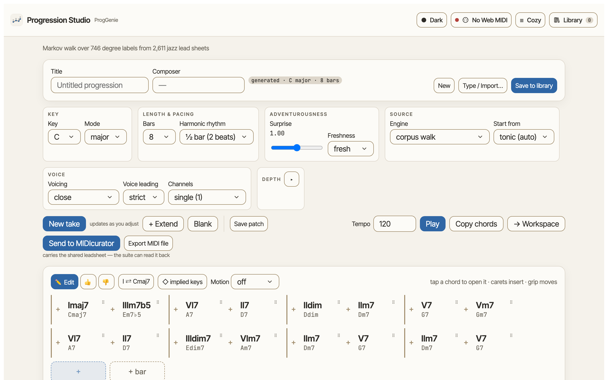
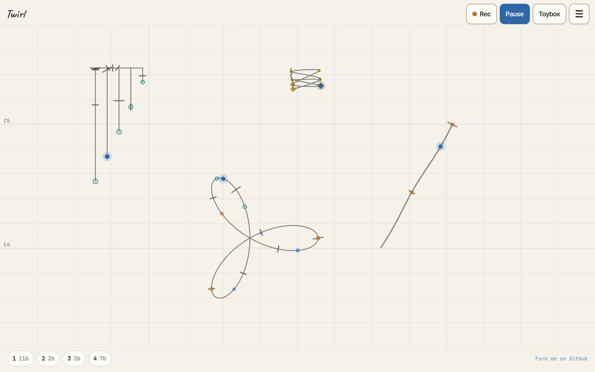
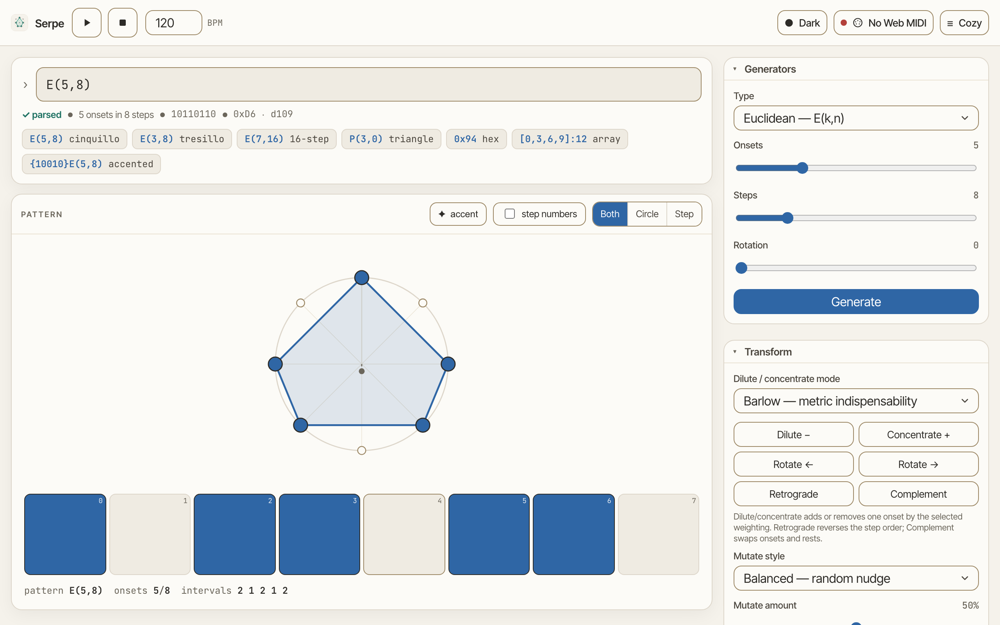
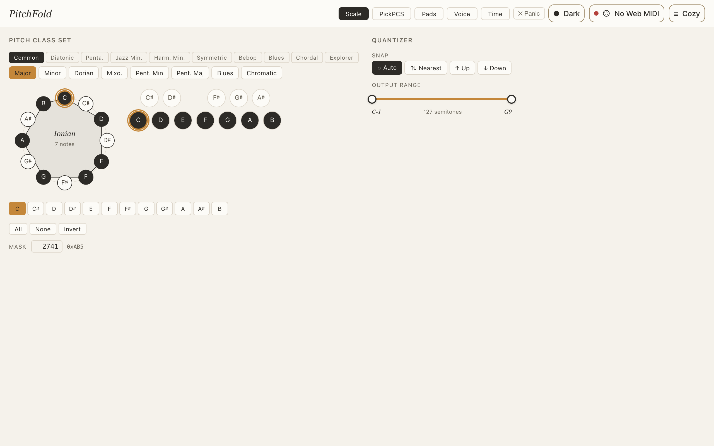
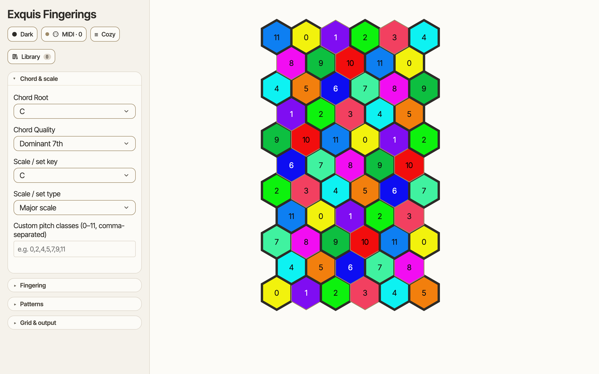
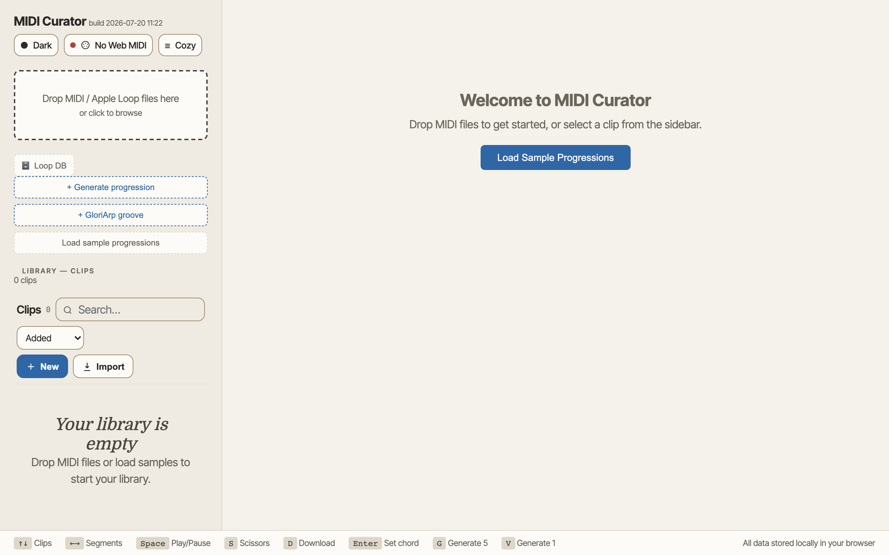
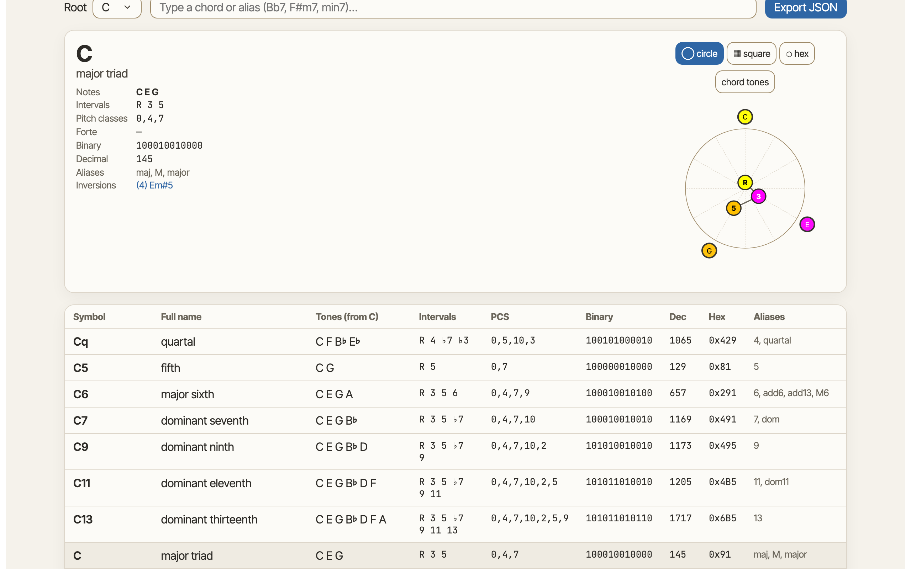
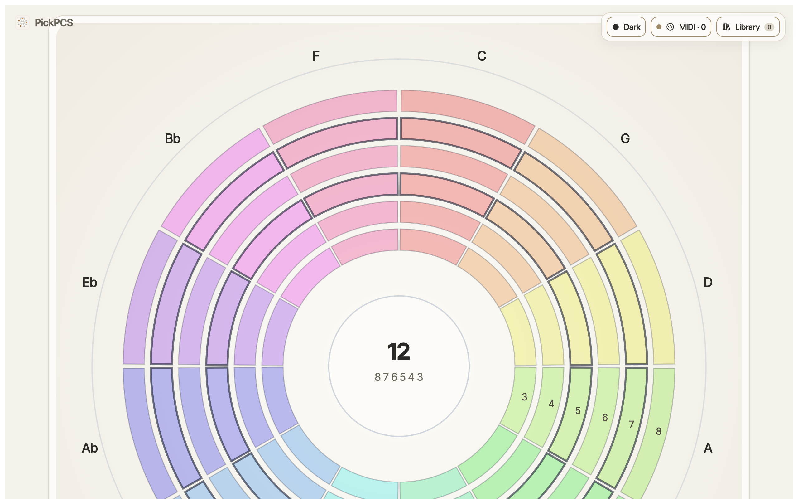
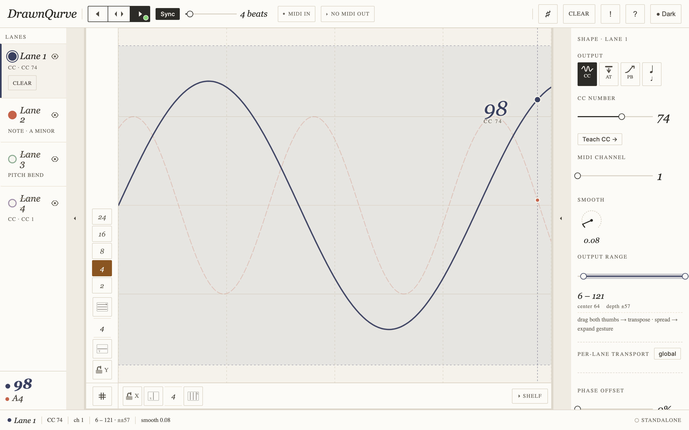
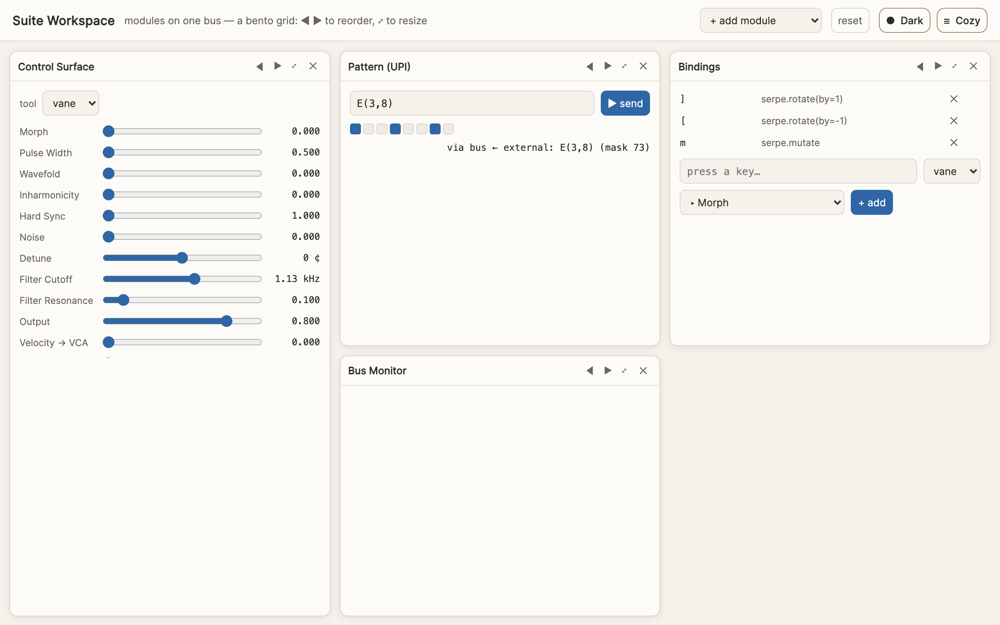

<!-- =====================================================================
     THE SITE, IN ONE FILE.

     This is the single source of all text on the Music Suite site. Edit the
     prose freely. Then run:  npm run build-site
     …which repopulates docs/index.html and docs/content/*.md from this file.

     The only rule: keep the `<!-- kind ... -->` marker lines intact — they
     tell the generator where each block starts. Everything between markers is
     plain Markdown you can rewrite however you like. (Re-ordering app cards is
     fine; just move a whole `card` block.)
     ===================================================================== -->

<!-- meta -->
title: Music Suite — a family of tools for playing with music
description: A family of tools for musical exploration: generate and shape chord progressions, curate MIDI patterns, explore chords and pitch. Webapps with standalone apps and plugins for macOS and iPadOS.

<!-- nav -->
brand: Music Suite
link: Apps -> #apps
link: The story -> doc.html?p=the-story
link: Guide -> doc.html?p=user-guide
link: Architecture -> doc.html?p=architecture
link: GitHub -> https://github.com/Enkerli/music-suite

<!-- hero -->
eyebrow: A family of Public Domain tools for musical exploration
heading: Play **with** music using Public Domain tools. Explore chords, rhythms, tunings, and expressive sounds
cta: [Read the story →](doc.html?p=the-story) primary
cta: [Browse the apps](#apps)

Playing *with* music is a unique experience. It’s about trying things, listening in new ways, noticing what you can’t really describe.
This suite provides a few Public Domain tools to explore different aspects of music. Chords, rhythms, tunings, expressive sounds…
Since all of these tools are in the Public Domain, you’re free to do **whatever you want** with them.

<!-- apps -->
The apps
Each app focuses on something specific and some can pass information to the other apps. Please note that some browsers don’t support the technology behind these apps. For instance, most of these apps don’t work in a browser on iPad (Twirl does). There are separate versions of most of these apps which do work on iPad and Mac.

<!-- card proggenie link=apps/proggenie/ docs=proggenie-story -->
ProgGenie (aka “Progression Studio”)
Generate jazz chord progressions, edit them on a leadsheet, play (with) them, understand some harmony.

<!-- card midicurator link=apps/midicurator/ -->
MIDIcurator
Collect MIDI clips and generate some variations.

<!-- card exquisite-fingerings link=apps/exquisite/ app=exquisite -->
Exquisite Fingerings
See chords and scales laid out on pad grids. Square pads (as on the Novation Launchpad or Ableton Push) or “hex” pads (as on the Intuitive Instruments Exquis).

<!-- card pickpcs link=apps/pickpcs/ -->
PickPCS
Explore sets of notes on an interactive ring, including chords and scales.

<!-- card chord-dictionary link=apps/chord-dictionary/ -->
Chord Dictionary
Look up chords and display them in a circle or on a grid (square or hex).

<!-- card style-gallery link=apps/style-gallery/ -->
Style Gallery
The suite's "paper & ink" design system, live — the colours, type, and components every app is built from.

<!-- card pitchfold link=apps/pitchfold/ -->
PitchFold
A scale and pitch quantizer. Build sets of pitches on the ring, snap incoming notes to them.

<!-- card drawnqurve link=apps/drawnqurve/ -->
DrawnQurve
Draw a “qurve” for notes, pitch, or modulation. You can quantize those by scale or rhythm.

<!-- card vane link=apps/vane/ -->
Vane
An expressive wavetable synth with support for breath, pressure, and slide. 

<!-- card serpe link=apps/serpe/ -->
Serpe
Explore rhythmic patterns and morph them.

<!-- card twirl link=apps/twirl/ docs=twirl-guide -->
Twirl
Draw a gesture and hear it. It keeps looping on its own clock, drifting, spinning, and spawning variations of itself. Works with a finger or a pencil on iPad, too.

<!-- docs -->
Documentation
Start with the suite story; the deeper docs cover ProgGenie.

<!-- doclink suite-guide page=suite-guide -->
Start Here — A Guide to the Suite
Doors into every tool: hear something now, explore rhythm, plug in a keyboard. No theory needed, no fixed order.

<!-- doclink the-story page=the-story -->
The Suite
A plain-language tour of the whole family — what it is and how the apps fit together.

<!-- doclink proggenie-story page=proggenie-story -->
ProgGenie — Story
What’s behind these chord progressions, anyway?

<!-- doclink user-guide page=user-guide -->
ProgGenie User Guide
How to use the ProgGenie chord progression generator, step by step.

<!-- doclink control-plane page=control-plane -->
Connecting & Automating the Tools
The command line, tool-to-tool messages, keyboard & MIDI shortcuts, and the workspace.

<!-- doclink architecture page=architecture -->
Architecture
The code: data model, theory modules, the three runtimes.

<!-- doclink twirl-guide page=twirl-guide -->
Twirl — Guide
Draw, hear, and play with loops that have a life of their own: every gesture, setting and key.

<!-- doclink history page=history -->
History & Roadmap
How it got here, and where it's going.

<!-- note -->
**Hosting note.** Every card opens a live build served from this same GitHub Pages site (`docs/apps/<slug>/`). All of them are built from source in the [music-suite repo](https://github.com/Enkerli/music-suite) on every change, including the web UIs that PitchFold, DrawnQurve, Vane and Serpe also run inside their plugins. In the browser those run standalone, without a plugin host. Twirl is a single HTML file with nothing to build.

<!-- footer -->
Music Suite · All these tools are Public Domain. ProgGenie uses transition statistics derived from the Impro-Visor imaginary-book corpus (GPL) without publishing the leadsheets. · [github.com/Enkerli/music-suite](https://github.com/Enkerli/music-suite)

<!-- page the-story -->

# The Music Suite — the story

*A plain-language tour of the whole set of tools, no music theory or coding required.*

## Several tools to play **with** music

This suite lets you explore different dimensions of music. You can use these tools to **play with** musical ideas. There are aspects you can see or read. Mostly, though, you should be able to listen to things in a different way.

You can learn about harmony by exploring chords and chord progressions. You can learn about rhythm by exploring patterns. You can also draw music and change it in unusual ways.

Each of these tools is the result of a separate [vibecoding](https://en.wikipedia.org/wiki/Vibe_coding) process. Each time, I started with an idea and interacted with Generative AI tools like Claude Code to make that idea into a usable tool. In other words, designing and developing these tools, like using them, is a form of open exploration.

At the same time, I’m making these tools look and feel similar to one another. Plus there’s some interaction between them. For instance, a chord progression from ProgGenie can be used in MIDIcurator and you can create an expressive “qurve” in DrawnQurve and play with it in the Vane synth.
 
## The shared foundation

Underneath every app sits a single **music-theory core** — a  library for knowledge about notes, chords, scales, rhythms, and how they relate. Every app draws on the same brain, so a chord named in one place means exactly the same thing everywhere. (That core is also the *reference*: its answers match regardless of version. In this way, the suite can grow without drifting.)

Most of these apps also share a look and feel: a calm **"paper & ink"** style, using the same colours and typography throughout. At some point, moving between tools should feel like staying in the same room.

## The apps

- **ProgGenie** *(aka Progression Studio)* — a front door to harmony. It writes jazz chord progressions
  drawn from the habits of 2,611 Jazz standards, lets you edit them on a leadsheet, plays them back, and quietly explains what's going on. It runs in a
  browser, as its own app, and as a plug-in inside studio software.
- **MIDIcurator** — a tool for musical pattern. Drop in MIDI clips, display them, play (with) them, and have their chords named for you. You can tag, rate, and search patterns in your library. You can also create variants of any pattern.
- **PickPCS** — a playground for **sets of notes**. Build a chord or scale on
  concentric rings laid out by the circle of fifths, and see how the bigger
  scale families and the smaller chords nested inside them relate.
- **Chord Dictionary** — the shared reference the others lean on: look up any
  chord by name or by its notes, with its spelling, its fingerprint, and its
  aliases. Plain, fast, and authoritative.
- **Exquisite Fingerings** — chords and scales laid out on **isomorphic pad
  grids** (square, like a Launchpad; hex, like the Exquis controller) — the way
  you actually reach for them. Highlight a scale, work out a fingering, save the
  shape.
- **Style Gallery** — the "paper & ink" design system itself, on a page: the
  colours, type, and building blocks every app is made of. If something looks
  wrong across the suite, this is where you'd see it first.

## How they fit together

I’m working a playflow for several of these tools. At this point, you can bring material from one tool to the other and play with it. In most cases, the transfer is about MIDI, an old protocol to get musical instruments and tools to communicate with one another. What’s brought over is musical information, not sound. Except in the case of the Vane expressive synth which produces sound.

Here’s a possible playflow:

> **harmony → curation → rhythm → expression → sound**

Write a progression in **ProgGenie**, send it to **MIDIcurator** to play with it and generate some variants, explore **rhythm** with **Serpe**, shape its **expression** with **DrawnQurve**, and give it a **sound** with **Vane**. 

There are plugin versions for most of these tools, for use in a plugin host or Digital Audio Workstation (DAW). These work on both Mac and iPad. Some even work on the Raspberry Pi.

## A standing promise

ProgGenie uses information derived from the leadsheets of 2,611 Jazz standards. It only
ever keeps the “habits” from these chord progressions: which chords tend to follow which. It doesn’t keep the songs
themselves. The original charts never left the machine and will never get published. The suggestions carry the collective data from thousands of tunes without copying any single one.

## Where they run

In a web browser, on a Mac, on an iPad, or inside studio software. They’re the same tools in different environments.

---

Want to go deeper on chord progressions? Read **[ProgGenie's own
story](doc.html?p=proggenie-story)**, its **[user guide](doc.html?p=user-guide)**,
the **[architecture](doc.html?p=architecture)**, or the
**[history & roadmap](doc.html?p=history)**.

<!-- page proggenie-story -->

# ProgGenie — the story

*A plain-language tour, for anyone — no music theory or coding required.*

## What it is

Many pieces of music are built around chords, sets of notes played together. Moving from one chord to another is an important part of musical structure in many genres. In Jazz, for instance, chords are the basis of improvisation as players will choose notes which fit a chord context.
The order of moves between chords is the “chord progression”.  ProgGenie (aka *Progression Studio*) is
a tool for generating, modifying, and understanding those progressions. It can serve as a chord progression sketchpad with some smarts built in.

## Where its ideas come from

Using a database of 2,611 Jazz standards, we’ve extracted the transitions between chords. What are the most likely options after a given chord? These transitions are set in a simple table that ProgGenie uses to generate chord progressions.
So its suggestions draw on
data from thousands of tunes.

## What you can do with it

- **Ask for an idea.** One button writes a fresh progression, any key, any
  length. Simple dials make it safer or more adventurous.
- **Make it yours.** Tap a chord to change it, move chords around, type a
  progression in by hand, or play chords on a music keyboard and have them
  written down for you.
- **Teach it your taste.** Give the moves you like a thumbs-up (and the ones you
  don't a thumbs-down); it remembers and leans your way next time. Your taste
  becomes a little profile you can save and reuse.
- **Hear it.** Play back the progression using an electronic instrument (such as a synth or sampler). While the progression plays, a *now-playing* card follows along, showing the
  current chord and what's coming next.
- **Pass it on.** Hand the result to the other tools in the family, or save it
  as a standard music file.

## It reads the music back to you

Beyond creating chord progressions, ProgGenie helps you understand them. It names each chord, shows
which notes are likely to work well over that chord and which to handle with care. The tool also points out
some important moments, such as a key change or a "coming-home" pattern. One tap flips
between chord names and a shorthand based on chords’ relationship to a key.

## The story so far

It began as a small experiment that could spit out plausible chord sequences. It grew into a more elaborate tool that we’re integrating into one member of a suite of music tools, some of which pass information to other tools. Along the way it was redesigned around a single
clear idea:

> The leadsheet is always the centre of the screen, and everything else is there to help it.

The generator proposes chords into the leadsheet, your playing writes into it, your taste colours it, the library remembers it.

From there it got a few more features around harmony, the relationships between chords, scales, and notes. The simple idea of holding things together in a leadsheet keeps the tool focused.

## Where it runs

The same program runs three ways: as a webapp, as a standalone app, and as a plugin inside music software. The webapp can be used on a variety of platforms, though not all browsers support it. The standalone and plugin work on both iPadOS and macOS.

<!-- page user-guide -->

# ProgGenie — User Guide

ProgGenie is built around a “leadsheet” as a series of chord names split across bars. By default, the tool generates a leadsheet. You can also type or paste a text version. Or add chords by playing them through MIDI. You can also rate a whole leadsheet or some parts of it. You can play it back using an electronic instrument. You can also send this leadsheet to another tool.

This guide walks through each of these possibilities.

---

## 1. Starting a progression — the four front doors

The **document strip** at the top names the current progression (title,
composer, a source badge) and offers four ways to begin:

- **New** — blank the sheet and start from scratch.
- **Generate** — *New take* re-rolls the generator (see §2). The sheet also
  updates live as you change generator settings.
- **Open…** — recall a progression from your **library** (the ones you've
  saved; the corpus itself is never browsable).
- **Type / paste a leadsheet…** (under *Import…*) — paste **bar notation** on
  one or more lines: bars split on `|`, a held bar repeats with `%`, chords
  within a bar are space-separated. Example: `Dm7 G7 | Cmaj7 | A7 | Dm7`. You
  can also **open a `.mid` file** (it reads the embedded progression).

A **blank sheet** shows a prompt with these options, so the text-entry path is
visible exactly when you'd reach for it.

> **Tip — chord names vs degrees.** When you paste chord names (`Cmaj7 Am7 …`)
> the editor switches to showing **chord names**. Flip any time with the
> **`I ⇄ Cmaj7`** button by the sheet (see §4).

---

## 2. Generating

The generator settings sit in labelled groups; the sheet regenerates live, and
**New take** re-rolls the random walk.

| Group | Control | What it does |
| --- | --- | --- |
| **Key** | Key, Mode | The home key (major/minor). |
| **Length & pacing** | Bars, Harmonic rhythm | How many bars, and the default chord length (1 beat … 4 bars, or *varied*). |
| **Source** | Engine, Start from | Corpus walk / corpus walk + cadence / circle of fifths; and an optional seed chord. |
| **Adventurousness** | Surprise, Freshness | *Surprise* reaches further down each transition's probability list; *Freshness* (faithful / fresh / bold) avoids clichés (repeats, quick returns, rote V→I). |
| **Voice** | Voicing, Voice-leading, Channels | Chord voicing shape; voice-leading mode (none / loose / strict); MIDI channel split (channels divide the output *by voice*). |
| **Depth** *(advanced ▸)* | Context, Reharm, Modulation | Generation depth — see below. |

**Depth** controls (occasionally set):

- **Context** — *variable-order Markov*. "2 chords" leans on what the corpus
  knows tends to follow a **two-chord** context (longer-range phrasing);
  "1 chord" is the plain first-order walk.
- **Reharm** — probabilistic **substitutions**: tritone (♭II7 for V7) and
  backdoor (♭VII7) dominants, *subtle* or *bold*.
- **Modulation** — **mechanical** key changes: a new corpus-common related key
  (dominant / subdominant / relative / up-a-step) every N bars, shown as real
  **sections** with a bold seam divider. (For *harmony-driven* key reading, use
  **implied keys** in §4.)

Everything is **seeded and deterministic**: the same settings give the same
progression. Save a whole settings set as a **Patch** (the *patch · Save…/Load…*
buttons) to recall a generator configuration later.

---

## 3. Editing the leadsheet

The leadsheet is a grid of bars; tap a tool, then work directly.

- **✏️ Edit** (default):
  - **Insert** — tap a **caret** (the `+` between cells, or the trailing `+`)
    to type a chord or pick a voice-led suggestion.
  - **Open a chord** — tap the cell to open the **inspector** (retype,
    consonance, duration, voicing lock/unlock, rate, why, the chord-scale grid,
    move, delete).
  - **Move a chord** — **press and hold** the cell to lift it (on desktop the
    cell shows a grab cursor; the `⠿` grip is the hint), then **tap a caret**
    to drop it. (Tap-the-grip → tap-a-caret also works, and is the
    keyboard-/precision-friendly path.)
  - **Duration** — in the inspector, a sole-in-bar chord can be held 1–4 bars
    (`%` repeat bars); a chord sharing a bar can be split to its own whole bar.
- **👍 / 👎** — *rating tools*: tap chords to reinforce or weaken the move
  *into* each one. This is **curation** (see §6); the cell tints to show it.

The **write cursor** is the blinking caret marking where the next inserted or
**played** chord lands; tap any caret to re-aim it (see §5).

---

## 4. Reading the harmony — display toggles (by the sheet)

These change how the sheet *reads*; none of them change the chords, the sound,
or the export.

- **`I ⇄ Cmaj7`** — show every chord as a **Roman degree** (composer view) or a
  **chord name** (reading/entering a known tune). Pasting chord names selects
  the name view automatically.
- **◇ implied keys** — **read the harmony** for local key areas: secondary
  dominants and ii–V–Is that tonicize a non-home chord (e.g. `A7 Dm7` → a brief
  D-minor area) are **re-spelled in their own key** with a **quiet tag** on the
  span (no divider, can start mid-bar). Works on generated, edited, **and
  pasted/imported** progressions — it's a re-reading, the chords don't move.
- **Motion** (off / notable / all) — the **transition-character overlay**: a
  **↝ arrow** marks root motion by a fifth (cadences: V→I, ii→V, secondary
  dominants), a **quiet underline** marks a step. *notable* hides ordinary
  diatonic steps so a busy tune isn't painted solid.

### The chord-scale (the inspector's hero)

Tap a chord to open its inspector and see its **chord-scale** on an
**isomorphic pad grid**:

- Geometry toggle — **▦ square** (chromatic rows in fourths; 5×5 ≈ two octaves)
  or **⬡ hex** (Exquis: major-3rd NE, minor-3rd NW).
- Roles read by **shape + glyph, never colour alone**: chord tone = solid pad,
  scale tone = outline, **tension** = dotted edge + `•`, **avoid** = dashed
  edge + `⊘`.
- A line names the scale and calls out avoid notes — **preferring the
  avoid-note-free scale** when one exists (e.g. Cmaj7 → *Lydian · or Ionian
  (avoid F)*).

---

## 5. Playing chords in by MIDI (plugin / standalone)

Route a MIDI keyboard into the plugin and play a chord. It's **identified and
held** (so you can release both hands), then shown as a **ghost cell at the
write cursor** inside the sheet:

- **✓** writes it, locking the **voicing as played**, and advances the cursor.
- **▸** opens *completions* ("one tone shy of a common chord") and *alternate
  voicings* (smoothest from the last chord), each one-tap.
- **✕** dismisses the held chord.
- Tap a caret to **re-aim** the cursor and write mid-progression.

The status line below the sheet shows MIDI routing and what's currently held.

---

## 6. Curation — shaping the generator's taste

Rating transitions builds a **profile** that biases what the generator
proposes (and what the MIDI picker suggests). Rate from three places — they all
feed **one functional, key-independent ledger**:

- per-chord **👍 / 👎** in the sheet (the move *into* a chord),
- **More like this / Bit meh** on a whole progression,
- the corpus stats view.

The curation panel shows **Your profile** as a *shape* — the strongest few
boosts and suppressions, with a count. The full ledger is one disclosure away
(**All weights**), with a **filter** (`from … into …` degree) — handy as the
list grows: "everything into V7". Because weights are functional, a V→I you
favoured in a C verse applies in a G bridge too. The inspector's **"why this
chord"** line closes the loop ("you favour V7→I").

Profiles **save/load** as JSON (Replace or Merge an incoming one).

---

## 7. Hearing it & the now-playing card

In the **web app and the JUCE standalone**, a **Play** button (with Tempo)
auditions the progression through WebAudio. In the **AUv3 plugin**, the **host
transport** drives playback (use your DAW's play button).

During playback a **now-playing card** follows the playhead: the **sounding
chord** big, its **chord-scale pad grid lit** (the tones pulse), and a **next
up** preview. The leadsheet's chord-follow highlight tracks the same playhead.

---

## 8. Sending it on — export & MIDIcurator

The progression travels as a **Standard MIDI File** that **embeds the canonical
progression** (so the suite can read it back):

- **Send to MIDIcurator** — the named destination; saves a leadsheet-bearing
  `.mid` you open in MIDIcurator.
- **Export MIDI file** — the same SMF as a plain file.
- **Copy chords** — the chord symbols to the clipboard.

Both routes write the same bytes through the native save/share path (no blob
downloads in the plugin's WebView). The filename uses the document title.

---

## 9. Library

**Save to library** snapshots the current progression (title · composer · key ·
bars · source) into local storage — the canonical Progression object, so locked
voicings and durations survive. **Open…** recalls one. The library holds **only
your own** progressions; the corpus is never browsable or exported.

---

## Keyboard & accessibility notes

- The leadsheet is operable by tap/click and keyboard; the move gesture has a
  no-drag fallback (tap to pick up → tap a caret to drop).
- Motion / role cues use **shape + glyph**, legible in greyscale and for
  colour-blind readers; colour only reinforces.
- Animations (cursor blink, the now-playing pulse) respect
  `prefers-reduced-motion`.
- Light "paper" theme is the default; **● Dark** is one tap away.

<!-- page suite-guide -->

# A Guide to the Suite

This is a set of small music tools that work together. They run in your
web browser, free, with nothing to install and no account to make. Some
also exist as plugins — versions that live inside music-making programs —
and as command-line tools, but the browser is the easiest way in, and
nothing here assumes you know music theory. If a musical word shows up,
it's explained right where it appears (and collected in the
[glossary](https://github.com/Enkerli/music-suite/blob/main/docs/GLOSSARY.md)).

Two things worth knowing before you start:

- **Your stuff stays yours, on your device.** These tools don't have
  accounts, don't upload anything, and save your work in your own
  browser. Anything you export is a file on your computer, in an open
  format.
- **There is no right order.** The doors below are starting points, not
  steps. Start wherever your curiosity points; every tool links to the
  others.

*One technical note, once: a few features send or receive **MIDI** — the
common language musical devices use to say "play this note now" (it
carries instructions, not sound). Browsers based on Chrome (Chrome, Edge,
Brave) can talk MIDI to your hardware; Safari and Firefox can't — in
those, everything still works except talking to external gear, and the
tools say so with a "No Web MIDI" label rather than failing silently.*

---

## Door 1 · "I want to hear something now"

Open **ProgGenie**: <https://enkerli.github.io/music-suite/apps/proggenie/>

Press **Play**. That's it — you're hearing a **chord progression**: a
sequence of chords (groups of notes played together), the harmonic
skeleton that most songs hang on. ProgGenie makes new ones by walking
through statistics gathered from thousands of jazz lead sheets — not by
copying any tune, but by learning which chord tends to follow which.



Things to try, in any order:

- **New take** — a different progression from the same settings. The
  **Surprise** slider decides how adventurous the walk is.
- **Tap any chord** to open it: what's in it, which scale fits over it,
  and a pad-grid picture of it. The 👍/👎 tools teach the generator your
  taste — future takes lean toward what you liked.
- **Key** and **Bars** do what they say. "Harmonic rhythm" is how often
  the chord changes — every beat, every bar, and so on.
- **Save to library** keeps a progression in your browser;
  **Export MIDI file** writes it as a `.mid` file — a small standard
  file of playing instructions that any music program can open.

If you'd rather hear a **groove** — a bassline or a comping pattern with
rhythm to it — walk through Door 6 to the Workspace and add its
**GloriArp** module, or see MIDIcurator's groove panel (Door 4).

Or, if you'd rather make the sound with your hands, open **Twirl**:
<https://enkerli.github.io/music-suite/apps/twirl/>

Draw anything on the sheet. You hear it as you draw it, and when you
let go it keeps going round as a **loop**, on its own clock. Higher on
the sheet is higher in pitch; the direction you move picks the sound
(right plucks, up rings a bell, down drums); a fast scribble is a shaker.
It works with a finger or a pencil on an iPad, too.



Things to try: drag a loop somewhere else and hear it change; hold one to
see its settings (speed, rhythm, chords, how it moves); open the
**Toybox** for ready-made shapes (wind chimes, roses, a drum beat); at the
**More** level, **Mutate** gives a loop a child, a close variation that
answers it, and **Life** lets a loop bloom, swell, fade, or come and go. With a keyboard, `?` lists every key.

---

## Door 2 · "I like rhythm"

Open **Serpe**: <https://enkerli.github.io/music-suite/apps/serpe/>

Serpe is a rhythm laboratory. A rhythm here is a **pattern**: a circle of
steps, some of which sound (onsets) and some of which are silent. You can
type patterns in a compact notation — `E(3,8)` means "spread 3 hits as
evenly as possible across 8 steps," which happens to be a rhythm heard in
music all over the world.



Things to try:

- Type `E(3,8)`, then `E(5,8)`, then `E(5,13)` into the input and press
  play. Tap steps on the lane or the circle to edit them directly.
- The **generators** (Euclidean, polygon, random, and friends) invent
  patterns; the **transforms** (rotate, reverse, mutate…) reshape the
  one you have.
- **Analysis** tells you *about* your pattern — how even it is, how
  syncopated (how much it plays against the expected beat).
- With a MIDI-capable browser, Serpe can drive real hardware or other
  apps from the MIDI section.

### Counting in longs and shorts (additive / aksak meters)

Plenty of music counts a bar as a mix of **long and short beats** rather than
equal ones. The Balkan 9/8 is *short–short–short–long*: 2+2+2+3.

Two ways to write that:

```
A(2,2,2,3)        the beat groups, outright
D:2,3 ...-        dots and dashes, saying a short is 2 and a long is 3
```

`A(...)` is usually the clearer one, and it handles meters that aren't just
two lengths — `A(2,2,3)` is a 7/8, `A(2,3,2,2,2)` an 11/8. Rotations are
different rhythms and you write them as such: `A(2,2,3,2)`, `A(3,2,2,2)`.

*(Without the `D:` part, a dot is one step and a dash is two — so plain
`...-` is a short five-step figure, not a 9/8. `D:` is what sets the sizes.)*

### Playing ahead of or behind the beat (push/pull)

Human players don't land exactly on the grid — they lean ahead of the beat or
sit back behind it, and the leaning comes and goes in phrases. Charles Keil
called these *participatory discrepancies*, and they're a lot of what makes a
groove feel alive rather than typed in.

```
A(2,2,2,3) PD(20%)      a light lean
A(2,2,2,3) PD(60%)      a strong one
```

Or use the **Push / pull** slider under *Feel*. Either way it changes **when
the notes actually play** — you'll hear it.

Three things it deliberately isn't:

- **not swing**, which is a fixed long-short subdivision, identical every bar;
  push/pull wanders and differs each time round;
- **not random jitter**, which just sounds like sloppy playing — this
  accumulates and resolves, so the rhythm leans and then settles;
- **not a tempo change** — the downbeat stays put and each cycle lasts exactly
  as long as it should, so you can play along with it. It leans; it never
  drifts.

### Making notes longer or shorter

**Durations (long/short)** reads the *gaps* between your onsets. A tresillo
(`E(3,8)`) has gaps of 3, 3, 2 — two long, one short — so Serpe shows it as
`--.` (dash = long, dot = short) and names the shape *antibacchic*. Even
rhythms like `E(4,8)` have no contrast to read, and the panel says so.

This is about **how long each note lasts** — its length, not its placement.
(For placement, see push/pull above.) Write it with `LS(...)`:

```
E(3,8) LS(3)                the classic: a long lasts 3× a short, steady
E(3,8) LS(1.4..1.8)         a RANGE — the contrast breathes within it
E(3,8) LS(1.4..1.8, 70%)    …and how strongly it moves
```

Type that in Serpe's pattern field and the Durations controls follow it. It
works the same at the command line — `msuite pattern "E(3,8) LS(1.4..1.8,
70%)"` — and alongside everything else the notation does, so
`{101}E(5,8) LS(1.5..2)` accents *and* breathes.

Or set the same thing with the two controls:

- **Ratio** — how much longer a long is than a short. One number holds it
  steady. Set the **second number higher than the first** and you have a
  *range* — the room the rhythm is allowed to move in.
- **Push / pull** — how much it actually moves inside that range. At 0 the
  rhythm is metronomic. Raise it and the long notes lean and relax as they
  go, hardest away from the strong beats and pulled back into line on them.

**A range with no push/pull, or push/pull with no range, does nothing** —
one is the room, the other is the reason to move. Writing `LS(1.4..1.8)`
without a depth assumes you meant it and uses the whole range; the panel
tells you when a setting is inert.

The movement is not random jitter. It accumulates and resolves, the way a
player leans into a phrase and settles at the downbeat — the same "pocket"
idea GloriArp uses for its timing, applied here to duration. And it is
repeatable: the same settings give the same performance.

### Naming rhythms

Rhythms travel under names. Under **Patterns**, *import named…* takes one
line or a whole pasted list:

```
Fume-Fume: [0,2,4,7,9]/12     positions that sound, out of 12 steps
Bembé: 0x5BA:12               hex, if that's how you have them written
Tresillo: 10010010            1 = a hit, 0 = a rest
Gahu: E(7,12)                 or any Serpe notation
```

They join your library under their names, tagged with what Serpe worked out
about them — so the bembé bell arrives labelled `E(7,12,7)`: a *rotation* of
the same even 7-in-12 that gives Gahu. A bad line tells you which line it
was, and the rest still import.

No rhythms ship built in. Which timeline counts as "the" bembé depends on
who you learned it from, and putting one spelling in the app would quietly
turn a choice into a fact. The vocabulary is yours to bring.

The same pattern language runs everywhere in the suite — the Workspace's
Pattern module, the command line (`msuite upi "E(3,8)"`), and the Serpe
plugin are all the same engine.

---

## Door 3 · "I have a MIDI keyboard (or pads)"

Plug it in and open one of these in Chrome/Edge/Brave:

- **ProgGenie** (Door 1) hears the chord you're holding, names it, and
  offers to add it to your progression — a nice way to build harmony by
  ear.
- **PitchFold**: <https://enkerli.github.io/music-suite/apps/pitchfold/>
  — choose a scale (a set of notes that sound good together), and
  PitchFold *folds* everything you play into it. Wrong notes stop being
  possible; mash the keyboard and it still comes out musical. Pick your
  keyboard under the MIDI chip (top right), pick a scale, play.

  

- **Exquisite Fingerings**:
  <https://enkerli.github.io/music-suite/apps/exquisite/> — for grid
  controllers (Exquis, Launchpad and similar), where notes are laid out
  in a honeycomb or square. It shows where chords and scales fall under
  your fingers, with the same colors the hardware uses.

  

No controller? Everything above also works with the mouse — you just
lose the "play it in" part.

---

## Door 4 · "I have MIDI files / I want to collect material"

Open **MIDIcurator**: <https://enkerli.github.io/music-suite/apps/midicurator/>

MIDIcurator is a library for short musical ideas — **clips**. Drop MIDI
files onto it (or generate clips right there) and it analyzes each one:
what chords it implies, how it moves, what's inside. You can tag, filter,
search, audition, and export.



Things to try:

- **+ Generate progression** or **+ GloriArp groove** if you have no
  files handy — the library fills itself.
- **GloriArp** is the suite's accompaniment maker: it learns a *style*
  from a clip you like ("☆ learn clip as style") and can then play that
  style over any chord progression — a walking bass, a comping pattern —
  with knobs for how busy, how loose, how surprising. Styles travel as
  small `.json` files you can share between the webapp, the plugin, and
  the command line.
- **Variants** makes controlled variations of a clip — same idea,
  different density or feel.
- Deleting is safe: things delete immediately with an **Undo** offer,
  and only "Clear All" asks first.

ProgGenie's **Send to MIDIcurator** button writes a MIDI file that
carries the whole progression inside it — MIDIcurator reads it back with
the chords intact, not just the notes.

---

## Door 5 · "I want to understand what I'm hearing"

Three reference tools, best kept open in a tab while you work:

- **Chord Dictionary**:
  <https://enkerli.github.io/music-suite/apps/chord-dictionary/> —
  167 chord types, each shown as notes, as a ring, and on a pad grid.
  The spelling is careful on purpose: the suite always names notes by
  their role (from G♯, the third is B♯ — not C), because the *function*
  of a note matters, not just its sound.

  

- **PickPCS**: <https://enkerli.github.io/music-suite/apps/pickpcs/> —
  a playground for **note sets**: pick any combination of the twelve
  notes and see what shape it makes, what it's called, and what it's
  close to. PickPCS can *push* a set you like straight into PitchFold
  as a scale — the two are designed as a pair.

  

- **DrawnQurve**: <https://enkerli.github.io/music-suite/apps/drawnqurve/>
  — less about notes than about *motion*: draw a curve with your finger
  or mouse and it becomes a control movement — a filter opening, a
  vibrato deepening — sent as MIDI. Runs on macOS, iPad, and Linux as a
  plugin too.

  

---

## Door 6 · "I want several tools at once"

Open the **Workspace**: <https://enkerli.github.io/music-suite/apps/workspace/>

The Workspace is a bulletin board of small modules — a pattern box, a
chord namer, a groove maker, a recorder, a synthesizer — that all listen
to one shared **bus** (a message channel: when one module makes a chord
or a pattern, the others hear it and can react).



Things to try:

- **+ add module** → **GloriArp**, generate a groove, and **+ add
  module** → **Vane Synth** — the groove plays out loud through a real
  synthesizer voice, right in the browser.
- **Recorder** captures what crossed the bus; **Library** keeps things
  you save; **Bindings** maps your computer keyboard (or MIDI knobs) to
  module controls; **Bus Monitor** shows the messages flying by, which
  is the honest way to learn how the suite talks to itself.
- The **Bridge (CLI)** module connects the page to command-line tools
  running on your computer (Door 7) — a terminal pipeline can play into
  your browser tab.

---

## Door 7 · "I prefer the command line"

Everything above also runs headless — no window, no browser — via the
`msuite` command. From a copy of the
[music-suite repository](https://github.com/Enkerli/music-suite):

```bash
npm install                      # one-time setup; builds everything
npm run msuite -- chord 60 64 67 # "what chord is C·E·G?"
```

(`npm run msuite --` is the no-setup launcher; `npm link -w @enkerli/cli`
gives you a bare `msuite` if you prefer.) The fourteen commands, one
line each:

| Command | What it does |
|---|---|
| `chord 60 64 67` | names the chord those MIDI notes make |
| `pattern "E(3,8)"` | rhythm codecs — binary, hex, onsets, all views of one pattern |
| `upi "P(3,0)+P(5,0)"` | the full Serpe pattern language, with analysis |
| `describe vane` | list a tool's controllable parameters |
| `generate --mode major --length 8 --seed 42` | a progression from the corpus statistics (same seed = same result) |
| `smf "Dm7 G7 \| Cmaj7" -o out.mid` | chord names → a MIDI file other suite tools can read back |
| `accompany --progression "Dm7 \| G7" --seed 42 -o bass.mid` | GloriArp: a bassline over your chords, with a trace explaining every note |
| `style learn in.mid --chord Dm7 --id mine -o model.json` | learn an accompaniment style from MIDI files |
| `render 60 64 67 -o out.wav --breath 0.9` | actual audio through Vane's real synthesizer voice |
| `… --play \| play --midi-out <port>` | sends a pipeline's notes to a real MIDI port (Linux-first; `play --list` shows ports) |
| `send --to serpe --param density=0.7` | a control message, printed as one line of JSON |
| `recv` | read/validate those messages from a pipe |
| `bind stage.json --cc 74=40` | resolve a hardware knob through a control map |
| `bridge` | serve a pipeline to the browser (the Workspace's Bridge module) |

The commands pipe into each other Unix-style — `msuite accompany
--progression "Dm7 | G7" --play --loop | msuite bridge` runs a groove in
your terminal and hands it to a browser tab. The full matrix of what
runs where: [HEADLESS.md](https://github.com/Enkerli/music-suite/blob/main/docs/HEADLESS.md).

---

## Door 8 · "I make music in a DAW"

A **DAW** (digital audio workstation — GarageBand, Logic, Ableton Live,
Reaper, AUM on iPad…) can host suite tools as **plugins**: the same
interfaces you've seen above, docked inside your project, synced to its
tempo and transport. Seven exist:

| Plugin | The same tool as… | Notes |
|---|---|---|
| ProgGenie | Door 1 | progressions follow the DAW's tempo; hears your MIDI keyboard |
| MIDIcurator | Door 4 | clip auditioning rides the DAW's play button |
| Serpe | Door 2 | the pattern engine drives your instruments |
| PitchFold | Door 3 | folds any track's notes into a scale |
| Suite Workspace | Door 6 | grooves leave as real MIDI; your hardware plays in |
| Vane | — | the suite's own instrument: a breath-first synthesizer, happiest with a wind controller or any source of expressive, continuous control |
| DrawnQurve | Door 5 | curves become automation for anything |

They're free, like everything here. Formats: AU, VST3, and standalone
apps on macOS; AUv3 on iPad; VST3/LV2 on Linux (plus CLAP for Vane and
the Workspace). Building them from source is spelled out, per platform,
in [BUILD.md](https://github.com/Enkerli/music-suite/blob/main/BUILD.md) — and on iPad, run a plugin's standalone app
once so the DAW notices it.

---

## How the pieces talk to each other

No magic, four mechanisms, all inspectable:

1. **MIDI files** (`.mid`) — the paper mail. ProgGenie exports one,
   MIDIcurator imports it; the suite tucks the full chord information
   inside the file, so meaning survives the trip.
2. **The bus** — the Workspace's shared message channel. Modules (and
   suite web apps in other tabs) publish chords, patterns, and scales as
   small readable messages; the Bus Monitor module shows them raw.
3. **MIDI itself** — live note and control messages, to and from
   hardware (Chromium browsers) and inside a DAW (plugins).
4. **The bridge** — a tiny local server (`msuite bridge`) that lets a
   command-line pipeline feed a browser tab on the same machine.
   Chrome is the reliable browser for this one; the details and rough
   edges are honestly listed in [BUILD.md](https://github.com/Enkerli/music-suite/blob/main/BUILD.md#3-connecting-the-deployed-workspace-to-your-local-machine-the-bridge).

## Where your things live

Saved progressions, styles, patterns, and settings stay in your
browser's local storage, on your machine — clearing the browser's site
data clears them, and exporting (MIDI or JSON files) is the durable copy.
The **Library** button in each app browses what you've saved. In plugins,
your work saves with the DAW project. The chord statistics ProgGenie
draws on are *derived numbers* (which chord follows which, how often) —
the underlying songbooks are not included, browsable, or reproducible
from them.

## Comfort

Every app shares the same top-right controls: **theme** (light/dark —
your choice sticks across all suite apps), **MIDI** status, and
**density** ("Cozy" spreads things out; compact fits more on screen).
Controls are keyboard-reachable, color never carries a meaning by
itself, and touch targets are sized for fingers. If something here falls
short for you, that's a bug worth reporting, not a fact of life.

---

*Words this guide introduced — chord, chord progression, MIDI, MIDI
file, DAW, plugin, standalone, bus, groove, pattern/onset, scale — live
in the [glossary](https://github.com/Enkerli/music-suite/blob/main/docs/GLOSSARY.md) with the suite's more technical
vocabulary. Everything in the suite is Public Domain: use it, change it,
share it, no permission needed.*

<!-- page control-plane -->

# Connecting & automating the tools

Every tool in the suite works on its own — you never need any of this to play
with chords, rhythms, or sound. But the tools can also **talk to each other,
run without a window, and be driven from a keyboard or a MIDI controller.**
This guide covers those features: the command line, tool-to-tool messages,
shortcuts, and the single-page workspace. Reach for them when you want to
automate a step, wire two tools together, or build a hands-free setup.

> **Two conventions worth knowing.** Rhythm and pitch-class numbers read
> **leftmost = smallest** (the first step is the *ones* place), so the tresillo
> over 8 steps is `0x94` / `73`. Chord progressions are written as **bar
> notation** — bars split on `|`, chords space-separated (`Dm7 G7 | Cmaj7`) —
> the same notation ProgGenie uses.

---

## 1. The command line — running tools without a window

The suite ships a small command, **`msuite`**, that runs the tools' engines
with no GUI, no DAW, and no plugin host. After `npm install`, run it from the
project folder — the root script works without any global install:

```
npm run msuite -- <command> …
```

(Prefer a bare `msuite`? `npm link -w @enkerli/cli` puts it on your PATH. The
examples below write just `msuite <command>` for brevity.)

The commands fall into three groups.

**Ask about music** — analysis, printed to the screen:

| Command | What it does | Example |
| --- | --- | --- |
| `chord` | name a chord from notes or pitch classes | `msuite chord 60 64 67 71` → `Cmaj7` |
| `pattern` | show a rhythm in every notation | `msuite pattern "E(3,8)"` → onsets `[0 3 6]`, `0x94`, `d73` |
| `upi` | the full Serpe pattern language | `msuite upi "P(3,0)+P(5,0)"` → a 15-step polygon pattern |

**Make something** — writes a file or audio:

| Command | What it does | Example |
| --- | --- | --- |
| `generate` | a chord progression from the corpus statistics | `msuite generate --mode major --length 8 --seed 42` |
| `smf` | bar notation → a Standard MIDI File | `msuite smf "Dm7 G7 \| Cmaj7" -o out.mid` |
| `accompany` | walk a bassline through a progression (GloriArp) — pick a style (`--source funk-ghost`, `bossa`, `two-feel`) or put the notes on any Serpe rhythm (`--rhythm "E(3,8)"`) | `msuite accompany --progression "Dm7 \| G7 \| Cmaj7" --rhythm "E(3,8)" -o bass.mid` |
| `render` | notes → audio through Vane's real sound engine | `msuite render 60 64 67 -o out.wav --breath 0.9` |

**Connect tools** — the messaging commands (`send`, `recv`, `describe`,
`bind`) get their own sections below.

> **Reproducible by seed.** `generate` takes a `--seed`; the same seed always
> gives the same progression, so you can re-find one you liked. Add `--tonic C`
> to see the chords spelled out (`Cmaj7 | Dm7 | G7 …`), or `-o out.mid` to write
> it straight to a MIDI file.

---

## 2. Piping one tool into another

Because each command reads and writes plain text, you can **pipe** one into the
next with the ordinary `|` your shell already has — one tool's output becomes
the next one's input:

```
# generate a progression, then hear it through Vane
msuite generate --length 4 --seed 3 --tonic C -o take.mid

# generate a progression and walk a bassline through it (GloriArp)
msuite generate --mode minor --length 8 --seed 7 | msuite accompany --seed 9 --tonic A --mode minor -o bass.mid

# perform that bassline as a live message stream…
msuite accompany --progression "Dm7 | G7 | Cmaj7 | A7" --play | msuite recv

# …or straight into the browser, looping as a continuous groove
msuite accompany --progression "Dm7 | G7 | Cmaj7 | A7" --play --loop | msuite bridge

# full duplex: the SAME command also lets the browser talk back — a knob
# turned in the Workspace tab lands on this shell's stdout
msuite accompany --play --loop | msuite bridge | msuite recv

# drive Vane's sound from a control message (see §5)
msuite bind stage.json --cc 74=40 | msuite render 69 -o knob.wav --stream
```

The middle lines are new: one tool *composes* the harmony, another *plays*
through it — and `--play` streams the result as real-time messages any suite
tool can listen to. The last line is the whole idea in miniature: a message
goes in one end and sound comes out the other, with no app open.

---

## 3. Sending messages between tools

The tools share a small common "note" they can pass around — a **scale**, a
**chord**, a **progression**, a **rhythm pattern**, a **parameter** change, a
**command**, or a **note to play**. Each message is addressed *from* one tool
*to* another (or broadcast to all).

- `msuite send --to serpe --param density=0.7` — set a parameter on a tool.
- `msuite send --to serpe --command mutate --arg amount=0.3` — tell a tool to
  do something.
- `msuite send --to vane --note 60,64,67 --duration 500` — play a chord on a
  voice: this is what lets ProgGenie, DrawnQurve, or MIDIcurator actually
  *sound* through Vane.
- `msuite recv` — read messages coming in and print them in plain language.

Put together, `msuite send … | msuite recv` shows a message making the trip.
Inside an app or plugin the same messages ride ordinary MIDI, so a web tool and
a plugin can talk the same way.

---

## 4. Seeing what a tool can be told — `describe`

Before you automate a tool, you can ask what it exposes:

```
msuite describe vane      # Vane's 36 sound parameters, with ranges and units
msuite describe serpe     # Serpe's steps/tempo/swing + its commands
```

Each **parameter** has a name, a range, and a unit (Hz, ms, cents, a 0–1 ratio…);
each **command** is a named action. This list is what shortcuts and the
workspace read, so anything `describe` shows, you can drive.

---

## 5. Keyboard & MIDI shortcuts — control-maps

A **control-map** connects an input — a keystroke, a MIDI knob (CC), or a pad
(note) — to a parameter or command on a tool. It's a small text file:

```json
{ "id": "cm-stage-01", "kind": "control-map", "label": "Stage layout",
  "bindings": [
    { "trigger": { "kind": "midi-cc", "cc": 74 }, "action": { "app": "vane", "param": "filter-cutoff" } },
    { "trigger": { "kind": "key", "combo": "mod+shift+m" }, "action": { "app": "serpe", "command": "mutate", "args": { "amount": 0.3 } } },
    { "trigger": { "kind": "midi-note", "note": 36 }, "action": { "app": "serpe", "command": "next-pattern" } }
  ] }
```

- **Check it** against the tools' parameters: `msuite bind stage.json --validate`.
  It tells you if a binding points at something that doesn't exist.
- **Try one**: `msuite bind stage.json --cc 74=127` turns knob 74 to full and
  prints the resulting message; pipe it onward to hear or log it.

A knob's position is mapped into the parameter's own range for you, following
how that parameter naturally moves — so a knob on Vane's filter, which sweeps
by ear rather than evenly, feels right end to end without any extra setup. A
saved control-map is yours to keep, recall, and share — a performer's layout,
including a keyboard- or switch-only layout, is a first-class thing you save,
not settings buried in one app.

---

## 6. The Workspace — several tools on one page

The **Suite Workspace** puts tools side by side as **modules in a bento
grid** — aligned tiles, no overlap: **◀ ▶** reorder a module, **⤢** cycles
its size (1×1, wide, tall, large), and the grid packs itself. All modules
share one message bus:

- a **Control Surface** — sliders and buttons built automatically from a tool's
  parameter list (Vane or Serpe), sending changes onto the bus;
- a **Pattern** module — type Serpe notation (`E(3,8)`) to draw a rhythm and put
  it on the bus; it also shows any pattern another module sends;
- a **Pattern Player** — makes whatever pattern is on the bus *audible*: a
  looping voice at your bpm and MIDI note. Send `E(3,8)` from the Pattern
  module, press play, and the tresillo ticks through the Vane tab;
- **Rhythm Analysis** — the same pattern, read instead of played: onsets,
  evenness, balance, syncopation, and every notation, updated live as
  patterns cross the bus;
- a **Progression** module — type changes in bar notation or generate them
  from the corpus statistics (same seed, same changes), then put them on
  the bus — where GloriArp picks them up. The compose-then-accompany loop,
  closed inside one page;
- a **GloriArp** module — the accompaniment engine itself, in the page: pick
  a style and a progression, shape the feel (rhythm, gate, dynamics, rests,
  push, variety, pocket, morph), press play — the bassline sounds through
  the Vane tab, and **⬇ .mid** downloads the identical take. One engine,
  everywhere;
- a **Keys** module — a tappable octave (with velocity, length, and octave
  controls) that plays notes onto the bus: audition Vane, feed the Chord
  Namer, or just noodle;
- a **Chord Namer** — names whatever chord flows by, using the suite's
  167-quality dictionary. Tap C-E-G-B on the Keys module and it says `C∆`;
- a **Recorder** — a message looper: record everything that crosses the bus
  (notes, knob rides, whole scenes) with its timing, then replay or loop it;
- a **Bindings** module — the control-map editor: a key (or, in the plugin,
  a hardware MIDI knob or pad) drives any module's parameters and commands;
- a **Bus Monitor** — the live stream of messages, so you can watch the tools
  talk;
- a **Bridge (CLI)** module — connects the page to a local `msuite bridge`, so
  a terminal pipeline (say, a GloriArp bassline played with `--play`) streams
  straight onto the page's bus — and out loud through the Vane tab. It's a
  two-way door: this tab's own knob turns and clicks travel back through the
  same bridge, so a terminal on the other end of the pipe can see them too.

Add or remove modules from the top bar; your arrangement is remembered. Open the
workspace in two browser windows and they share the same bus, so one window can
drive another.

---

## 7. Going deeper

This guide is the friendly tour. The technical reference — every command, the
message format, and the design behind it — lives in the project's
`docs/HEADLESS.md` (what runs without a GUI) and `docs/CONTROL_PLANE.md` (the
messaging and shortcut system). Those are written for people working on the
code; you don't need them to use anything above.

<!-- page architecture -->

# Progression Studio — Architecture

How the code is organized and why. ProgGenie is one React app
(`apps/progression-studio`) that leans on shared, framework-agnostic suite
packages (`@enkerli/theory`, `@enkerli/ui`, `@enkerli/midi`) and runs unchanged
in three environments (web, JUCE standalone, AUv3 plugin).

```
music-suite/                      (monorepo; npm workspaces)
├── apps/progression-studio/      ← this app (React + Vite)
│   └── src/
│       ├── App.jsx               the whole UI + the generation/analysis pipeline
│       ├── generate.js           Markov walk, voicing, rhythm, variable-order blend
│       ├── curation.js           the taste layer (transition multipliers, profiles)
│       ├── exportMidi.js         SMF export (embeds the canonical Progression)
│       ├── chordInput.js         held-note tracker → detected chord (MIDI in)
│       ├── library.js            localStorage progression library
│       ├── juceBridge.js         browser ⇄ JUCE bridge shim (copied from foundation)
│       └── data/
│           ├── transitions.json  first-order corpus table (derived stats)
│           └── trigrams.json     second-order corpus table (derived stats)
├── packages/theory/              ← @enkerli/theory (pure, TypeScript, vectored)
├── packages/ui/                  ← @enkerli/ui (framework-agnostic create*(el,opts))
└── packages/midi/                ← @enkerli/midi (SMF core + leadsheet round-trip)
```

The JUCE plugin is a **separate repo** (`progression-studio-plugin`) that
embeds this app's built bundle in a WebView — see [The three runtimes](#the-three-runtimes).

---

## The data contract: `Leadsheet` / `Progression`

The keystone type lives in `@enkerli/theory` (`leadsheet.ts`). Everything — the
generator, the editor, MIDI import/export — is an instance of it.

```ts
interface Progression { key: KeyContext; meta?: {…}; sections: Section[]; }
interface Section     { label?: string; key?: KeyContext; bars: Bar[]; }   // key → modulation
interface Bar         { chords: ProgChord[]; repeat?: boolean; }           // repeat = "%" held bar
interface ProgChord   { source: "degree"|"absolute"; degree?: RomanDegree;
                        symbol?: {root,suffix,bass}; voicing?: number[]; inputText?: string; }
```

Key points:

- A chord holds a **degree** (key-relative Roman) and/or an **absolute** symbol;
  `realizeChord(chord, key)` fills the other from the key. Degree chords
  re-realize per key; absolute chords are key-invariant.
- A **Section** carries an optional `key` — that's how **modulation** works:
  `realizeLeadsheet` realizes each section against `section.key ?? prog.key`.
- **Durations aren't stored.** A bar's chords divide its beats by the leadsheet
  convention (`divideBar`: 3 → ½+¼+¼); a chord held past a bar becomes a
  whole-bar chord + `%` repeat bars. Inserting/removing re-divides — no
  overflow.

`parseLeadsheet(text, key)` and `formatLeadsheet(prog)` round-trip bar notation.

---

## The corpus and its statistics

The source is Carey Bunks's Jazz-Chord-Progressions corpus, derived from
Impro-Visor's imaginary-book lead sheets (GPL). **The lead sheets are never
published** — only **derived statistics** ship:

- `packages/proggen/src/data/transitions.json` — first-order **pair** counts per degree transition
  (`"IIm7": {"V7": …}`), per mode.
- `packages/proggen/src/data/trigrams.json` — second-order **context** counts (`"prev2 → prev1":
  {next: …}`), pruned to count ≥ 3 and ≥2-option contexts.

Both are regenerated by `@enkerli/corpus-tools` (`regenerate-transitions
<corpusDir> <outPrefix> --respell`) over the local corpus; the CLI never copies
the corpus, only the counts. `--respell` matches the canonical published table.

---

## The generation → display pipeline (App.jsx)

A single `useMemo` chain turns settings into the displayed progression. Each
stage is pure and seeded:

```
rhythm   = rhythmPlan(bars, harmonicRhythm, seed)           // a per-bar plan
labels   = generateSections(table[mode], mode, { …, trigrams, smart })
           → a seeded Markov walk of degree labels (IIm7 V7 Imaj7 …)
           · variable-order: blendTrigram folds the second-order distribution in
           · curation multipliers + gesture triples + variety re-weight the walk
reharmed = applySubstitutions(labels, { tritone, backdoor })   // count-preserving
baseProg = modulate==="off" ? buildProgression(reharmed, rhythm, key)
                            : buildProgressionSectioned(…, keyForBar)  // mechanical
effectiveProg = (edited && edited.genId === genId) ? edited.prog : baseProg
chords   = chordsFromProgression(effectiveProg, key)   // realized per section key
voicings = voiceProgression(chords, { voiceLeadMode, voicingShape })
```

### `genId` — generated vs edited

`genId` is a string of every **generation** parameter (key, seed, bars, rhythm,
surprise, freshness, engine, start, reharm, modulate, context, opCount). An
**edit** is stamped with the `genId` it was made under; while that matches,
`effectiveProg` is the edit, otherwise it falls back to the fresh generation.
This makes "generate vs hand-edit" a synchronous, single-source decision — no
post-render reconciliation. The React editor is **remounted** (via `key={genId}`)
on a generation op so internal edits aren't clobbered.

### Display analyses (don't touch the chords)

- **Implied modulation** (`showImplied`) — `analyzeKeyAreas` over the displayed
  chords' home-key functional degrees → flat-index `keyAreas` spans, passed to
  the editor, which **re-spells per chord** (via the real root, so a degree
  chord re-spells without transposing) and shows a quiet tag. Curation reads the
  area key too (functional ledger stays correct).
- **Motion overlay** (`showMotion`) — `transitionMotion(fromPc, toPc, key)` →
  `motionOf(i)` → the editor draws ↝ / underline in the gap before each chord.
- **Chord-scale grid** — `scaleGridOf(i)` builds a per-pc role map from
  `chordScaleFor`; the editor (inspector) and the now-playing card render it via
  the shared `pitch-grid`.

---

## `@enkerli/theory` modules (pure, vectored)

| Module | Responsibility |
| --- | --- |
| `leadsheet.ts` | The `Progression` type, `parseLeadsheet`/`formatLeadsheet`, `realizeChord`/`realizeLeadsheet`. |
| `analysis.ts` | `assertDegree` (note → Roman degree in a key), `resolveDegree` (Roman → spelled note), degree frames. |
| `chords.ts` · `chordSymbol.ts` · `chordDetect.ts` | Chord quality dictionary, symbol parsing, pcs-based detection. |
| `spelling.ts` · `pitch.ts` · `pcs.ts` | Structural note spelling, pitch helpers, PCS codecs (LSB-first). |
| `voiceLeading.ts` | Taxicab (L1) voice leading — the suite's reference implementation. |
| `chordScale.ts` | Chord → scale (structural classifier) + tensions + **avoid notes**, **preferring the avoid-note-free scale**; returns alternates with their own avoid notes. |
| `substitutions.ts` | Reharmonization over a label stream: tritone / backdoor / passing-dim, mode-aware, seeded. |
| `modulation.ts` | Corpus-common related keys + `planModulation` (mechanical, every-N-bars). |
| `keyAreas.ts` | **Implied modulation** detection — ii–V–I / secondary-dominant tonicizations → local key areas. |
| `motion.ts` | **Transition character** — root-interval classification (fifth / step / …) + `notable`. |
| `rhythm.ts` | Bar-plan / harmonic-rhythm primitives. |

All ship with pinned **vectors** (`*.test.ts`); the Lua/C++ ports of the codecs
must match the same vectors.

---

## The shared editor (`@enkerli/ui/leadsheet-editor.js`)

`createLeadsheetEditor(el, opts) → handle`. Framework-agnostic (plain DOM),
driven by the `Progression` type. The same editor serves ProgGenie
(degree-authored) and MIDIcurator (absolute).

It owns its `Progression` after mount and emits `onChange(prog)`; the React
wrapper (`LeadsheetEdit` in App.jsx) reads callbacks through refs so the picker,
ratings, and analyses always see current app state. Key opts/callbacks:

- structure: `suggest(ctx)`, `onChange`, `tool` (edit / rate-up / rate-down).
- analyses: `ratingOf` / `onRate`, `rationaleOf` (why), `scaleOf` (text),
  `scaleGridOf` (the pad-grid roles), `motionOf` (motion overlay), `keyAreas`
  (implied modulation spans, flat-indexed).
- input: `ghost` (the held live-MIDI chord → an inline cell at the **cursor**;
  the editor does the insertion via `writeAtCursor`).
- display: `display` (functional/absolute), `gridLayout` (square/hex, shared).

Addressing is `(si, bi, ci)` — section, bar, chord — with a flat chord index for
chord-follow and ratings. Structural editing is **direct manipulation** (carets,
press-and-hold move, the inspector) — no modes except the two rating tools.

Other `@enkerli/ui` pieces used here: `pitch-grid` (isomorphic pad grid with the
chord-scale role overlay + `now` playback pulse), `piano-roll` (the Progression
shape), the design tokens (`tokens.css` / `components.css`, "paper & ink").

---

## The three runtimes

`juceBridge.js` exposes `bridge.kind` (`"juce"` in plugin/standalone, else
browser) → `IN_PLUGIN`. The same bundle adapts:

| | Web | JUCE standalone | AUv3 plugin (in a DAW) |
| --- | --- | --- | --- |
| Playback | WebAudio **Play** button | WebAudio **Play** button | **host transport** drives it |
| Detection | `!IN_PLUGIN` | `IN_PLUGIN` + `runtime.wrapper ~ "Standalone"` | `IN_PLUGIN`, host-driven |
| MIDI in | — | bridge `midiNotes` | bridge `midiNotes` |
| File I/O | `<input>`/anchor | native picker via bridge | native picker via bridge |
| Chord-follow | local playhead | local playhead | host beat → chord |

WebView constraints shape the I/O: **no** `window.confirm/prompt/alert`, **no**
blob/data downloads (they kill the page), files go through
`bridge.saveFile(name, bytes)` / `bridge.openFile(patterns)` → `fileOpened`.

The plugin embeds the app as a **single-file bundle** (`WebUI/index.html`,
regenerated by `node WebUI/build.mjs` after app changes).

---

## Building, testing, and the validation ladder

Web: `vite build`. Tests: `vitest` (838 specs across the suite — theory vectors,
generation, curation, the editor, the components).

The plugin runs a **validation ladder** on every change (from the plugin repo):

1. `node WebUI/build.mjs` — rebuild + embed the bundle; WKWebView smoke.
2. `cmake --build build` — macOS AU/VST3/Standalone.
3. `auval -v aumi Prst Enke` — expect "AU VALIDATION SUCCEEDED".
4. `pluginval --strictness-level 8 --validate "…/Progression Studio.component"`.
5. signed iOS (`xcodebuild … -allowProvisioningUpdates`).

> The iOS rung periodically fails at **provisioning** ("No Accounts…") when the
> Xcode signing account lapses — not a code regression. Fix it by re-adding the
> Apple developer account in Xcode → Accounts.

<!-- page history -->

# Progression Studio — History & Roadmap

The story of how ProgGenie became what it is, and where it's headed. The
suite-wide plan of record is `SUITE_AUDIT_AND_PLAN.md` (a local-only repo); this
is the narrative.

---

## 1. A generator looking for a home

ProgGenie began as a **seeded Markov generator**: walk the transition statistics
of 2,611 imaginary-book jazz lead sheets, realize the resulting degree labels in
any of 17 keys with proper structural spelling, voice them with taxicab voice
leading, and play them back. Early additions made it musical rather than
mechanical — a **temperature** knob (how far down each transition's probability
list to reach), **channel-split** voices, **chord-follow** highlighting, and
**SMF export**. The hard rule from day one: the corpus lead sheets are never
published — only the derived statistics.

Then came **ear-driven curation**: per-transition weight multipliers over the
immutable corpus counts. You could say "this change sounds good" or "this whole
progression's a bit meh," and the generator would lean accordingly —
deterministic per (seed, profile), exportable as a JSON profile. Curation
quickly became the strongest, and messiest, use case.

## 2. Joining the suite

ProgGenie stopped being a standalone toy and became one app in a **monorepo**
("music-suite") with a shared **"paper & ink"** design system and shared,
framework-agnostic packages. The keystone was a single **`Leadsheet` /
`Progression` type** in `@enkerli/theory` — suddenly the generator's output,
MIDIcurator's clips, and MIDI files were all the same object. A **shared
leadsheet editor** followed, plus a **ChordID** MIDI-input path (play a chord,
it's identified and added) and **voice-led voicing suggestions**. The app also
became a real **AUv3 MIDI processor** and **standalone**, the same web bundle in
a JUCE WebView, validated through auval / pluginval / signed iOS.

## 3. The leadsheet-first redesign (UX critique, steps 01–06)

A Claude Design critique reframed everything around one diagnosis: ProgGenie
flattened **three different objects** — the progression (the artifact), the
generator (a patch), and the profile (curated taste) — into one toolbar, so the
most important thing had no home. The fix, built as a six-step sequence:

1. **Editing coherence** — between-chord insertion carets, a chord inspector,
   direct-manipulation move/delete; tool-modes survive only for rating.
2. **Generator grouped** — the flat row became labelled groups; "Generate" →
   *New take*; **Patches** save/recall a settings set.
3. **Library & import** — the progression became a **document** with four front
   doors (New · Generate · Open · Import), backed by a localStorage library.
4. **MIDI input unified** — live MIDI writes into the document; the two-place
   flow collapsed to one.
5. **Curation summarized** — the profile shown as a *shape*, not a ledger, tied
   into the inspector's "why this chord."
6. **Send to MIDIcurator** — name the destination, not the file format.

## 4. Track C — generation depth

In parallel, the generator grew **theory-led depth**, each piece a pure,
vectored module:

- **Chord-scale relationships & avoid notes** — a structural classifier mapping
  each chord to its scale (maj7→Lydian, 7→Mixolydian, m7♭5→Locrian, …), with
  **avoid notes** computed structurally, **preferring the avoid-note-free
  scale**.
- **Substitution engine** — probabilistic tritone, backdoor, and passing-dim
  reharmonization over the label stream.
- **Key changes** — modulate to corpus-common related keys.
- **"Smart" generation** — a real **second-order (variable-order) Markov** model
  built from corpus **trigrams**, with back-off to the first-order table.

## 5. The design decisions (Q1–Q6) and beyond

A second design pass answered six open questions, and the build that followed
went well past them through tight iteration:

- **Q2 — multi-section keys.** Modulation became *real sections*, each
  re-anchoring `resolveDegree` to its own key, with a quiet seam divider.
- **Q3 — generator taxonomy.** Five groups by intent; "Sound" → **Voice**;
  depth knobs behind *advanced*.
- **Q5 — chord-scale pad grid.** The inspector's hero: an isomorphic pad grid
  (square = fourths, hex = Exquis) with roles by **shape + glyph, not colour**.
- **Q6 — filter-by-degree curation**, surfacing one functional ledger.
- **Q4 — transition-character overlay** (↝ fifths / underline steps, *notable*).
- **Q1 — the write cursor + inline MIDI ghost + press-and-hold move gesture.**

Then the most interesting thread: **implied modulation**. Rather than chopping
mechanically every N bars, *read the harmony* — detect ii–V–I / secondary-
dominant tonicizations and **re-spell** those spans in their own key, quietly,
inline, **mid-bar capable**, on generated **and pasted/imported** tunes alike.
Finally, **live playback**: a **now-playing card** follows the playhead, the
current chord's scale grid lighting in real time, with a "next up" preview — and
the standalone got its **Play button** back (it has no host transport).

The through-line never changed: **one document, everything else assists it.**

---

## Roadmap

Near-term, mostly captured in `SUITE_AUDIT_AND_PLAN.md` and
`DESIGN_QUESTIONS.md`:

- **MIDIcurator App Group inbox** — the *live* ProgGenie → MIDIcurator handoff
  (today it's a leadsheet-bearing `.mid` you open there). Needs a shared App
  Group container, entitlement wiring, an inbox dir, and a MIDIcurator ingest
  path. Gated on the Apple developer account; also fixes the standalone↔AUv3
  library split.
- **Implied modulation on imported tunes, surfaced.** Detection now runs on any
  displayed progression; the natural next step is a clearer entry point ("find
  the keys in this tune") and tuning the density on busy charts.
- **Passing-dim substitution in ProgGenie.** The engine supports it; inserting a
  chord changes the slot count, so the rhythm plan must re-derive.
- **Design round-2 UX bits** (`DESIGN_QUESTIONS.md`): first-class text entry,
  the functional/absolute toggle's placement/default, the now-playing card's
  always-on vs playback-gated behaviour and its position.

Longer-term, the suite's signature workflow — Progression Studio (harmony) →
MIDIcurator (curation) → Serpe (rhythm) → DrawnQurve (expression) → Vane (sound),
connected by MIDI in a host — plus the chord-scale grid paying forward into
PitchFold and exquisite-fingerings, and variable-order generation maturing off
the accumulating gesture-curation data.

<!-- page twirl-guide -->

# Twirl — Guide

Twirl is a toy for drawing music. Draw a stroke and you hear it as you
draw it. Let go and it keeps going round, as a **loop**, on its own clock.
Draw another and the two play together. Loops drift, spin, can be moved,
turned, stretched, muted, and can have children.

**Play it:** <https://enkerli.github.io/music-suite/apps/twirl/>. It works
with a finger, a pencil or a mouse, in any current browser, iPad Safari
included. Nothing to install, no account; your work stays in your browser.

## The first minute

Tap anywhere: that starts the sound (browsers wait for a touch). Three
loops are already on the sheet: wind chimes, a dropped line and a shaker,
in a key and at a tempo of their own (a fresh sheet picks a common key,
major or minor pentatonic, between 84 and 112 beats a minute).
**Start over**, in the controls, brings Twirl back to this first visit:
the starting sheet, every setting as Twirl begins, the Simple level (two
taps). Your saved scenes, toys and takes stay, and for ten seconds after,
the same button brings back what you had.
Draw something of your own. Then drag one of the loops somewhere else and
listen to what changes.

## How a drawing becomes music

- **Higher on the sheet is higher in pitch.** The horizontal lines are the
  notes of the scale you're in (pentatonic, to begin with). The lines
  labelled C4, C5… are the octaves.
- **Distance along the path is time.** The sheet's width is one bar of four
  beats; the vertical lines are the beat divided. The little ticks across a
  loop show where each beat falls on it.
- **The direction you move picks the sound.** Right plucks, up rings a
  bell, left blips, down drums. Scribble back and forth quickly and you get
  a shaker. Each sound has its own colour *and* shape (● ○ ▲ ■ ◆), so you
  never need the colour to tell them apart.
- **Size is speed.** Make a loop bigger and it plays slower; smaller,
  faster. Sizes snap to musical ratios (½, ⅔, ¾, 1, 4⁄3, 1½, 2), so loops
  of different sizes still meet up.
- **Loud is fast (or firm).** Drawing faster makes louder notes; with a
  pencil, pressing harder does. Bigger dots are louder.
- **Where the notes land.** As you draw, a note lands each time the line
  has gone a set distance, and wherever it turns sharply, so corners and
  curls get notes and long straight runs get them evenly spaced. **Notes:
  few / some / many** sets that distance (few, the default, is about two
  grid columns). Any loop can change its own later: hold it → **Notes**.
  Choosing the same setting again re-rolls: the notes land a little
  differently each time.

A blue dot, the **playhead**, travels each loop; a note sounds when the
playhead reaches it.

## Touching loops

| Gesture | What it does |
|---|---|
| Drag a loop | Move it (its pitches and timing change with where it is) |
| Flick it off the edge | Throw it away |
| Two fingers on a loop | Turn it and resize it (resize = speed) |
| Tap | Mute / unmute |
| Double-tap | Change how it moves on its own: still, drift, spin, jitter |
| Hold | Its settings |

Every one of these also has a one-tap or keyboard way to do it: the
loop's settings have **Place** buttons (move and turn), **Mute** and
**Erase**, and the keys are listed below. Each loop also has a numbered
chip along the bottom; tapping a chip opens that loop's settings, which
is the easy way to reach a small or busy loop.

## Simple, More, Everything

Twirl opens at **Simple**: draw, hear, toys, scenes. **More** adds the
musical controls: the scale (*grid*) and its root, the range in octaves,
how the beat is divided, the pen, **Lock**, **Morph**, swing, **Air** and
**Arc**. **Everything** adds tunings, **Revoice**, **Walk** and **Drone**.
Each level only adds; nothing moves. Switch levels in the controls drawer
(☰) or right in a loop's settings.

The ones worth knowing:

- **Lock** reads every loop on the beat grid instead of as you drew it: a
  steady pulse, with the pitch snapped to the lines. Move a locked loop and
  its rhythm changes, because it crosses different lines.
- **Morph** lets loops move on their own. Off, they stay where you put
  them. (If your device asks for reduced motion, Twirl starts with it off.)
- **Air** gives a busy sheet room to breathe: the notes that matter least
  in the bar rest, and weaker beats play softer. Downbeats always play.
- **Arc** shapes 4 or 8 bars as tension and release: home, away, pull, and
  home again, where melodies resolve.
- **Walk** (Everything) moves everything, the Drone too, along the scale
  every few bars: *a progression* (round and round), *sway* (home and the
  fourth), *by fifths* (through every degree), *climb* (a step at a time),
  or *wander* (a step or a fifth, up or down); every 1, 2, 4 or 8 bars;
  **W** cycles through them. What it does: every note moves by the same
  number of *scale steps*, so a melody keeps its shape and moves within the
  scale (its intervals follow the scale: a major third may become minor),
  and a chord loop's chords follow too, their quality set by the scale (as
  I becomes vi). Each loop can take its own part (its settings, Everything
  → Walk): **moves** (as above), **stays** (holds while the rest moves: a
  pedal, a riff), or **fits** (keeps its own pitches, but each note goes to
  the nearest tone of the chord Walk has moved to: a line that adapts).
- **Tunings** (Everything): equal, just, Pythagorean, meantone and
  Werckmeister III for 12-note scales; microtonal scales (5-, 7-, 19-,
  24-EDO, slendro, pelog, maqam Rast, harmonics, Bohlen–Pierce) bring their
  own.

## A loop's settings

Hold a loop (or tap its chip, or press its number then Enter). From top to
bottom: how it **moves** on its own and where it **lives** (high, middle,
low: it wanders but comes home), **Place** (move and turn), and its
**volume**. From More up: its **notes** (few, some, many, or ↻ again),
what it does when it **touches** another loop (below), its **life** and
its **influence** (below), its **voice** and
**sounds** (the sheet's, or another pack's: a loop can bring its own), **speed**, **rhythm** (as drawn,
evenly spaced, or Euclidean), **direction** (forward, reverse,
ping-pong), how often it **plays** and **waits**, when it **starts**,
**chords** (fifths, triads, sevenths, sus, always in the scale you're in),
and its **timing** (follow Lock, always as drawn, or always on the grid).

**Edit notes** (More and up) changes a loop by hand: tap anywhere on its
path to add a note, tap a note to remove it, double-tap a note to change
its sound (pluck, bell, blip, drum, shaker, or back to by direction), drag a
square to bend the path, hold to smooth it.

**Mutate** (More and up) gives the loop a child: a close variation with
the same voice, rhythm and timing, a slightly different shape, and a few
notes nudged. It starts half a cycle behind its parent, so it answers it.
Children can have children; the chips show the generation (`g1`, `g2`…).

## When loops touch

Loops touch in three ways, and a small ring flashes where they do:

- a loop's playhead (its blue dot) **crosses another loop's line**. This
  happens all the time, wherever lines overlap;
- two **lines come into contact**, when loops move into each other
  (drifting, bumped, or dragged). Lines that already overlap don't count:
  only the moment they touch;
- two **playheads meet**: they reach the same place at the same moment.
  This is rarer, and you can aim for it by moving loops around.

Each loop answers in its own way (its settings → **Meets**):

- **sound**: it plays a note where it touches, so a crossing adds a note
  and a meeting is an interval, two voices at once;
- **bump**: it also pushes the lines it crosses or touches out of its way,
  so loops push each other around the sheet;
- **trade**: when its line touches another, or its playhead meets another,
  it also borrows one thing from the other loop: its voice, its chords, its
  rhythm or its direction, one at a time, in turn;
- **breed**: when its playhead meets another, it also has a child, a
  variation of itself (like Mutate) that borrows one thing from the other
  loop;
- **infect**: an infectious loop has a child at *any* contact. Use it
  sparingly: children fill the sheet;
- **no**: it stays out of it.

A loop crosses a given line at most once a beat; a loop trades at most once
every two bars and breeds at most once every sixteen. On a full sheet (14
loops), a child takes the oldest loop's place (never one of its parents),
so a full sheet keeps evolving; **⌘Z** brings the old one back. Breeding is
always your choice: a child never
inherits it, and Surprise never gives it. **Meet** in the controls (More)
turns all of it off.

**Surprise** (More, on at first): a new loop may get a different direction
(reverse, ping-pong), rhythm (even, Euclidean) or way of meeting (bump,
trade; never breed). The usual
ones stay the most likely, a message says when a loop got something else,
and you can change it in the loop's settings. Turn Surprise off and every
new loop plays forward, as drawn, and sounds when it touches. The Toybox's
beat and shaker keep their own feel either way.

## Loops with a life

A loop can change over the passes instead of playing the same way for good.
Hold it → **Life**:

- **steady**: as drawn, for good (most loops);
- **bloom**: denser, and back. More notes come in, beyond the ones you
  drew (the same path, read more finely), over eight passes, and leave over
  eight, and round again. The notes that matter most to the beat come
  first; your own notes always play;
- **swell**: louder, and back: from soft to full over eight passes, then
  softer again;
- **fade**: a little quieter each pass, and gone after sixteen;
- **brief**: comes and goes. It starts from its strongest notes, fills in
  to all of yours over eight passes, fades over eight, and it's gone.

Next to Life, its length: **8, 16, 32 or 64 passes** of the loop, or **1 to
32 bars**: a cycle for bloom and swell, the whole life for fade and brief
(16 passes to begin with). In bars, loops of different sizes fade over the
same time.

**Copy** (in a loop's settings, More) gives this loop's life, influence,
way of meeting, sound, part in Walk or timing to **its family**, **all
loops**, or **loops you choose**: tap *to loops I choose…*, tap their chips
at the bottom, then **Apply**. Copying a life starts them all together,
this loop too; then each one's length can be changed on its own (several
loops fading at once, at different rates).

You can see it: the line gets thicker as a loop fills and paler as it
fades; a bloom's extra notes show small while they play, and resting notes
are faint. The loop's settings say where it is ("blooming · pass 5 of
16"). Shakers, beats and chimes have fixed notes, so they don't bloom.
With **Surprise** on, once the sheet has four loops or more, a new loop is
sometimes given a life (brief, or a fade of 16 or 32 passes, most often), so a busy sheet keeps changing;
a message says so, and a first stroke on a quiet sheet always stays. A loop whose life ends goes
where undo puts loops: **⌘Z** brings it back, steady. A loop only ages while
it plays (not muted, not held), and **Evolve** in the controls (More) holds
every life where it is. Its drawn notes never change: choosing **steady**
gives it back exactly.

## Timing, more freely (Everything)

Every loop keeps time with the sheet and snaps to its division (the
vertical lines): that's what keeps things together, and it's how Twirl
starts. At **Everything**, a loop's settings add three ways out:

- **Snap**: to the *division* (as always), *fine* (1/64: almost as drawn,
  still in time), or *none* (exactly when you drew it);
- **Feel**: ahead of the beat (pushing) or behind it (laid back), up to
  40 ms either way, the same every pass (Vary is the random kind);
- **Clock**: *in step*, or *drifts ahead* / *drifts behind*: one per cent
  fast or slow, so it slides against the others and, many passes later,
  comes round into step again (phasing). A drifting loop plays unsnapped.

The sheet's **division** (More) now goes down to 1/64 too, or **Free**.
Setting these loop by loop gets tedious, so **Same for: its family · all
loops** hands one loop's Snap, Feel and Clock to its family (its parent and
children) or to the whole sheet. Only when you ask: a new loop is always in
step, snapped, on the beat.

## Loops that feed and drain each other

A loop can also change the loops it touches (any of the three kinds of
contact). Hold it → **Influence**:

- **none**: it leaves them as they are (most loops);
- **feeds**: the loop it touches grows stronger, louder and denser (more
  notes come in, as in a bloom). A loop that fades, or is brief, is kept
  young while it's fed;
- **drains**: the loop it touches grows weaker, quieter and sparser. A
  fading loop runs out sooner.

Strength settles back a little every pass, so it lasts only as long as the
touching goes on. Put a fading loop where a feeder keeps crossing it and it
stays; move it away and it dies out. You can see it: a fed line is thicker,
a drained one paler, and a double ring (feed) or a dashed one (drain)
flashes where it happens. A loop's settings show its strength. **Evolve**
off holds it all where it is; **Meet** off stops all contact. With
**Surprise**, once the sheet is busy, a new loop sometimes feeds or drains.

## Vary

**Vary** (More, on at first): no two notes come out quite alike. Each one is
a little louder or softer, a few milliseconds earlier or later, a few cents
off, and a little brighter or duller (the bell more or less clangorous, the
blip longer or shorter), the way a sampler plays a different take of the
same note each time. It takes the edge off fast repeats. Turn it off for
exact, identical repeats.

## Toys, scenes, takes and codes

- **Toybox**: ready-made shapes (spiral, ring, rose, Lissajous, a drum
  beat, a shaker, wind chimes, a spinner, dice for a surprise). Tap one to
  drop it. A **Spinner** is a quick flick upward, a beat long: a drum, then
  bells rising, evenly spaced. It spins, so the little arpeggio folds toward
  one note as it turns sideways, opens up again, and turns upside down.
  **Chimes** look like chimes: a bar with tubes of different lengths, and
  the longer the tube, the lower its note. They ring in gusts, off the
  beat, over a long cycle, and bring their own sound, whatever the sheet's
  pack.
- **My toys**: "Keep a loop", then tap a loop on the sheet, and it becomes
  a toy you can drop again anywhere.
- **Scenes**: six slots for whole sheets. Tap an empty slot to save, a
  full one to recall; hold it (or Shift-tap, Shift-Enter) to overwrite. Your
  last sheet also comes back by itself.
- **Takes**: press **● Rec**, play, press it again. A take keeps what you
  *did* (strokes, moves, settings) and replays it on the sheet, even after
  a reload. In a replay each loop appears as it was drawn, in the
  drawing's own time; the timer and Stop shrink to a small dot after a
  moment, out of the picture for a screen recording (tap it to get them
  back); its sound stays until you close the page, unless you save it:
  **Save sound** gives you a WAV file, which opens everywhere.
- **Download everything**, in Scenes: a JSON file of your sheet, scene
  slots, My toys and takes (what you did, not their sound), readable and
  yours to keep; **Open a file** brings one back (scenes fill empty slots,
  the sheet comes in as a scene, toys and takes join yours).
- **Codes**: a sheet, a toy, a take, or everything you have, as a line of
  text (`twirl:s1.…`). Send it any way you like; paste it into Scenes →
  Paste a code, on any device. Nothing is uploaded anywhere: the music is
  inside the code.

## Keyboard

Every touch on the sheet draws, so the keyboard is how to steer without
leaving marks. **H** lists every key inside Twirl.

| Keys | What they do |
|---|---|
| Space | Play / pause, wherever the focus is (⇧ Space: record). Inside an open panel it presses the focused button instead, and never pauses; Enter presses a focused button anywhere |
| 1–9, or Tab / ⇧ Tab | Pick a loop |
| Enter | Its settings (Enter again closes them) |
| Arrows · `,` `.` | Move it · turn it |
| `<` `>` · X · D | Slower / faster · mute · duplicate |
| ⇧1 … ⇧6 | Pen: by direction, drums, pluck, bell, blip, shaker |
| T · Y · S | Toybox · My toys · Scenes |
| C | Controls (Tab then moves through them) |
| L · M · E | Lock · Morph · Edit notes |
| F | Full screen |
| I | Messages: shown as they happen, or quiet |
| W · ⇧W | Walk: off, then each way in turn (⇧W: back) |
| Q · ⇧Q | Diagnostics (frames a second, how late the clock runs, notes a second, errors, where the last tap landed) · ⇧Q copies a report |
| ⌘Z · ⇧⌘Z | Remove the newest loop · bring it back |
| Esc (or `` ` ``, or ⌘ .) | Close whatever is open |

**Tab** moves through the controls of whatever panel is open (a loop's
settings, the controls, a shelf) and wraps around at the ends, so it never
falls out into the address bar; in a dropdown too, `` ` `` or ⌘ . closes
the panel.

**On an iPad with a keyboard:** tap the page once after it loads, so it
hears the keys (Safari keeps the keyboard in the address bar until then).
The Magic Keyboard has no Esc key: use `` ` `` (where Esc would be) or
⌘ . instead, or turn Caps Lock into Escape in Settings → General →
Keyboard → Hardware Keyboard → Modifier Keys. Safari's Tab usually skips
buttons (⌥ Tab reaches them), which sent focus off to the address bar; that
is why Tab steps through loops in Twirl, and C, Enter and T take you into
the controls.

If the system interrupts the sound (a call, another app's audio), Twirl
says so, and the next touch or key brings it back.

On a busy sheet or a slower device, Twirl looks further ahead when it
schedules notes, so they don't drop, and may draw the sheet a little less
sharply until things calm down. **Q** shows how it's keeping up.

## Messages

Twirl keeps quiet about what it does. When something happens (a setting
changes, a loop trades, a child is born, a loop fades away), a small dot
in the footer lights up; tap it for **What just happened**, the last few
messages. **Show messages** in the controls (or the key **I**, or the
switch in that list) shows every message on the sheet as it happens,
stacked, so none is lost. Both are handy for a screen recording: quiet for
a clean picture, shown to explain what's going on. Only a problem that needs
you (the sound was interrupted, a save that failed) shows when quiet.
Screen readers hear every message either way.

## Full screen

**F**, or **Full screen** in the controls drawer: a bigger sheet, and a
clean frame for screen recordings. F again (or Esc) to leave. If drawing
downward knocks the page out of full screen (some tablets read it as the
"leave" gesture), it comes back as soon as you lift your finger. Full screen
isn't available everywhere: browsers inside other apps often don't allow
it, and the button only appears where it works.

## MIDI out

In browsers with Web MIDI (Chrome, Edge and other Chromium browsers,
including on Linux), an **Out** picker appears at the Everything level:
send Twirl's notes to a synth, a DAW or hardware, with or without Twirl's
own sound. Plucks go out on channel 1, bells on 2, blips on 3, drums and
the shaker on 10 (General MIDI drum notes). Microtonal pitches are rounded
to the nearest semitone for now. Safari has no Web MIDI; a plugin version
is on the [roadmap](https://github.com/Enkerli/music-suite/blob/main/apps/twirl/ROADMAP.md).

## Behind it

Twirl is Public Domain (CC0), one HTML file you can read, copy and change:
[source on GitHub](https://github.com/Enkerli/music-suite/tree/main/apps/twirl).
Its [README](https://github.com/Enkerli/music-suite/blob/main/apps/twirl/README.md)
explains how it works inside, the
[roadmap](https://github.com/Enkerli/music-suite/blob/main/apps/twirl/ROADMAP.md)
where it's going (sustained sounds, terrain, harmony, Workspace and a plugin
are among the next steps), and
the [accessibility record](https://github.com/Enkerli/music-suite/blob/main/apps/twirl/A11Y.md)
what has and hasn't been tested.

